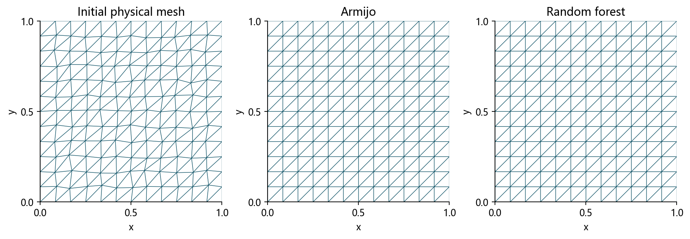
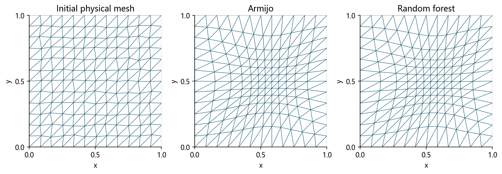
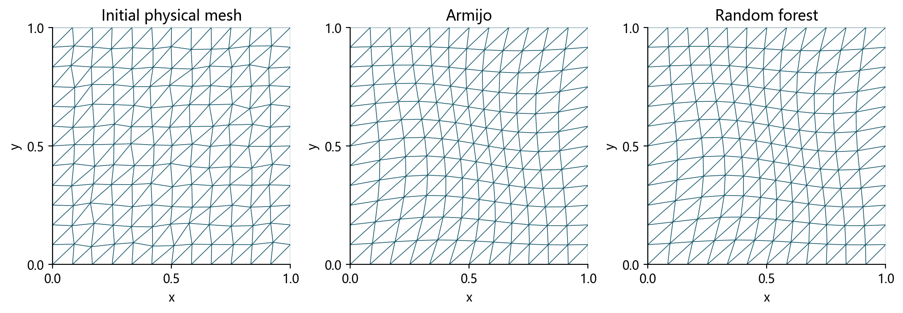
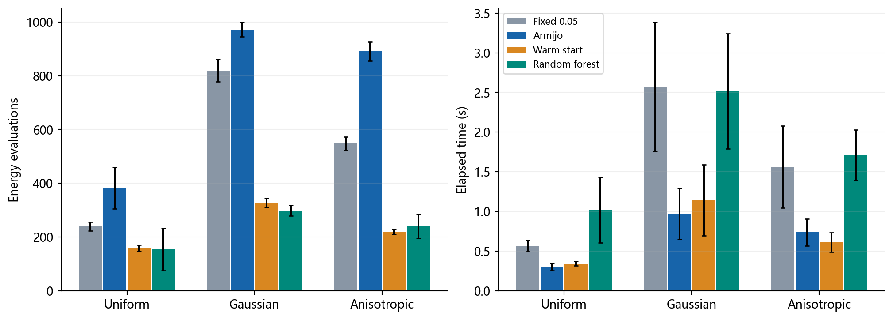
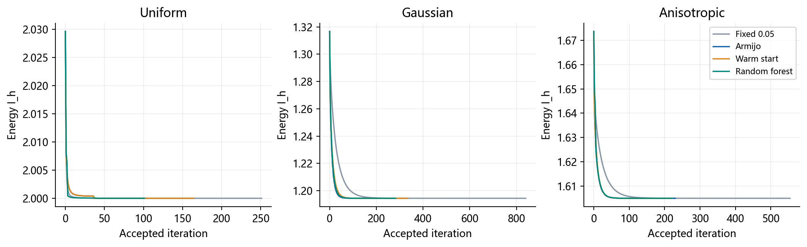
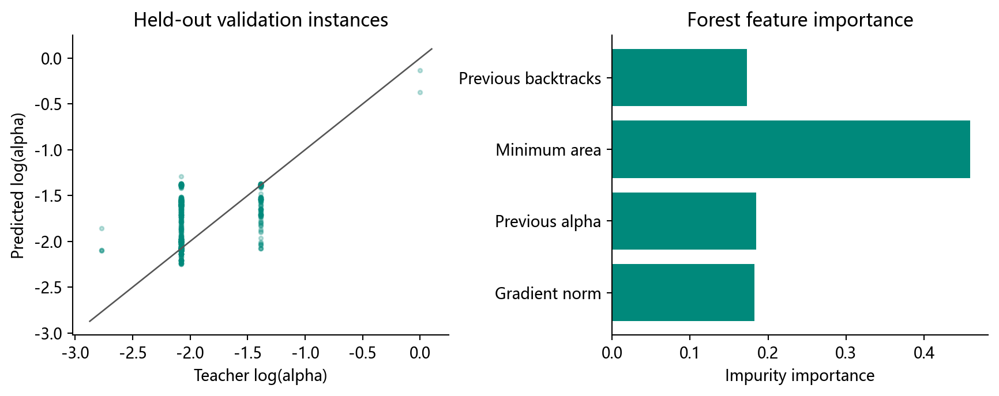

# 随机森林能让网格优化更快吗？

机器学习课程设计 · 二维变分网格 · 课堂讲解约7分钟

## 1 研究问题：少算几次，是否就更快？

在169个顶点、288个三角形的小网格上，预测一个初始步长能否减少线搜索成本？我们训练了随机森林，在三个度量场、九个未见实例上完成四种方法共36次测试。全部达到共同精度，最终网格无翻转。

**实测结论：评价次数下降，总耗时上升。** 随机森林相对固定初值 Armijo 的能量评价次数分别减少 59.9%、69.4% 和 73.1%，但总耗时分别为其 3.38、2.60 和 2.33 倍。在本次小规模网格上，学习初始步长未带来端到端加速。

## 2 网格怎样移动：能量与逆映射

物理网格 $X$ 固定，优化计算网格 $Q$，再通过分片线性逆映射在规则参考顶点上求值，获得新的物理网格。

$$
I_h(Q)=\sum_K|K|\,\operatorname{tr}(J_KM_K^{-1}J_K^T),\qquad J_K=B_KE_K^{-1}.
$$

这是已有 Winslow 离散能量的简化梯度优化比较。原模块五项测试通过，六次新增方向差分的最大相对误差 6.45e-09。

## 3 森林只提议步长，接受条件统一

标准 Armijo 从1开始；热启动从前一步接受步长开始；固定步长0.05；随机森林用4个当前可用特征预测对数步长。所有方法必须通过同样的网格和充分下降检查。

$$
Q_{k+1}=Q_k-\alpha_k g_k,\qquad
I_h(Q_{k+1})\le I_h(Q_k)-10^{-4}\alpha_k\|g_k\|^2.
$$

计算与重建物理三角形的定向面积须大于 $10^{-12}$。森林预测不满足条件时按 $1/2$ 退缩，必要时回退默认初值。

## 4 实验设置：按完整实例隔离

训练24个、验证6个、测试9个完整实例，训练步骤 4620 条。每个实例的所有步骤只进入一个集合；三类度量各有3个测试种子，四种方法从相同初始网格出发。随机森林32棵树、深度10，固定随机种子，未用测试结果调参。

停止条件统一为 $\|g_k\|\le\max(10^{-7},10^{-4}\|g_0\|)$。推理、特征提取和网格重建都计入求解耗时；教师数据生成与训练成本单列。

## 5 三个算例：实际网格发生了什么？

### 均匀度量：恢复规则

### 高斯度量：局部集中

中心圆内节点数18 → 39。集中由度量和能量驱动，两种方法得到接近的平衡网格。

### 各向异性：局部定向变形

固定方向 $v=(\cos(\pi/6),\sin(\pi/6))$，正定度量 $M=I+wvv^T$。图中均为预先固定的展示种子100，完整测试结果全部保留。

## 6 方法比较：评价更少，时间更长

|算例|方法|迭代数|能量评价|回溯数|时间/s|最终能量|
|---|---|---:|---:|---:|---:|---:|
|均匀度量|固定步长|238.0|239.0|0.0|0.566|2.00000001|
|均匀度量|Armijo|100.0|382.0|299.7|0.301|2.00000001|
|均匀度量|热启动|155.0|158.0|4.0|0.341|2.00000001|
|均匀度量|随机森林|149.7|153.0|2.3|1.016|2.00000001|
|局部高斯度量|固定步长|818.7|819.7|0.0|2.573|1.20041767|
|局部高斯度量|Armijo|270.0|972.7|736.0|0.969|1.20041766|
|局部高斯度量|热启动|325.0|327.0|3.0|1.143|1.20041767|
|局部高斯度量|随机森林|274.3|298.0|22.7|2.517|1.20041766|
|各向异性度量|固定步长|547.3|548.3|0.0|1.563|1.60743644|
|各向异性度量|Armijo|228.0|891.0|677.0|0.736|1.60743643|
|各向异性度量|热启动|217.7|219.7|3.0|0.610|1.60743644|
|各向异性度量|随机森林|215.3|240.0|23.7|1.710|1.60743643|

随机森林总耗时中的 64.8% 用于特征与预测。小型目标函数很便宜，省下的候选评价抵不过预测成本。热启动无需训练，也显著减少回溯。

## 7 机器学习表现：标签与预测都要检查

验证 MAE=0.1848，$R^2=-0.5623$；直接沿用上一步的 MAE=0.1638。负 $R^2$ 说明森林弱于标签均值预测。教师标签是二分回溯的接受步长，不是最优步长。数据生成 21.17s，训练 0.43s；当前没有时间收益可摊平训练成本。

## 8 结论、局限与复现入口

实际选择：本实验优先简单 Armijo 或热启动；不能只凭少了多少次函数评价判断加速。

局限：每类只有3个未见实例；同分布测试；一次批量计时；冻结度量；没有PDE误差比较。本实验是显式梯度优化的对照，不是原论文 ode15s 的直接加速。

离线查看：同目录 `report.html`；完整论文在项目 `paper/paper.pdf`；数据在 `data/results.csv`；从项目根目录运行 `python scripts/reproduce.py` 复现。浏览时可使用 PageDown/PageUp、Home/End 滚动，顶部 More 菜单提供原生成器的打印功能。

## 9 参考资料

[1] Huang W., Kamenski L., Russell R. D. A comparative numerical study of meshing functionals for variational mesh adaptation. Journal of Mathematics Study, 2015, 48(2): 168–186. DOI: 10.4208/jms.v48n2.15.04. [预印本](https://arxiv.org/abs/1503.04709)。

[2] Kamandi A. Learning the initial step size and backtracking reduction factor for the Armijo line search. Journal of Mathematical Modeling, 2026, Articles in Press, Corrected Proof，2026-08-18 在线发表. DOI: 10.22124/jmm.2026.33801.3107. [期刊页面](https://jmm.guilan.ac.ir/article_9844.html)。

[3] Wu T., Liu X., An W., Huang Z., Lyu H. A mesh optimization method using machine learning technique and variational mesh adaptation. Chinese Journal of Aeronautics, 2022, 35(3): 27–41. DOI: 10.1016/j.cja.2021.05.018. [期刊页面](https://www.sciopen.com/article/10.1016/j.cja.2021.05.018)。
