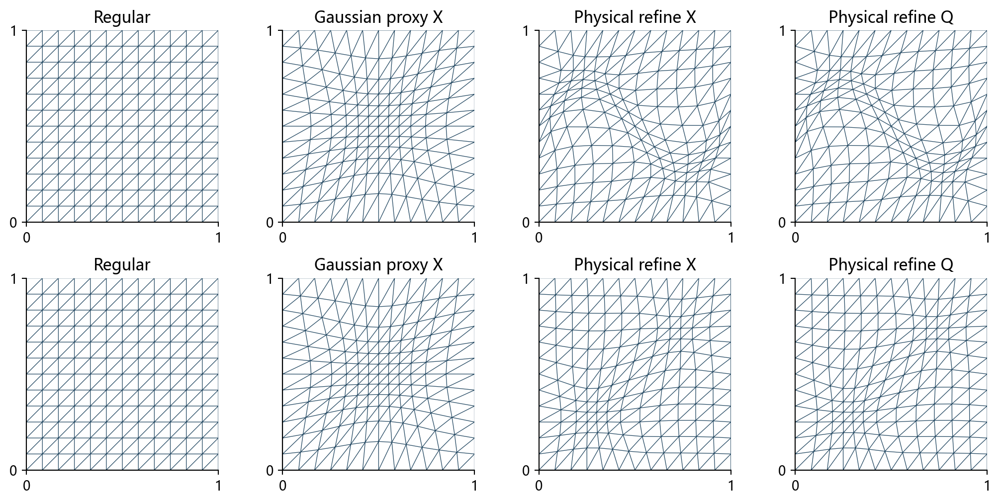
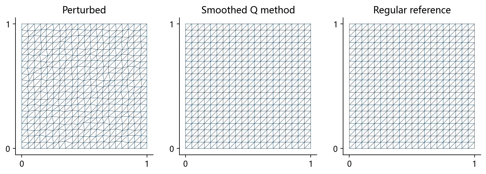

# 机器学习辅助二维变分网格：课程实验与适用边界

用一个小型MLP从四个高斯参数预测网格，再比较直接使用、坐标重建和传统变分精修。这里保存可运行代码、真实数据、中文论文和课堂汇报，以及泛化测试和数学分析。

**当前结论：模型在相近高斯参数上可用作近似和优化初值；现有证据不支持通用数据、任意规模或“学习X普遍优于学习Q”的结论。**

## 独立扩展研究：物理教师训练

课程实验之后，新增两次独立探索：[带图总览与探索脉络](扩展研究/README.md)。
先比较相同扩展数据下直接X与Q重建，再用物理能量实际生成1200训练/400验证/400测试教师。
新物理X模型插值RMSE较旧Q重建模型降低约5.96%；20例同目标精修平均迭代从207次降到112次，配对加速约1.96倍。
这是当前非线性物理求解器的初始化收益；固定网格与高斯范围之外的效果仍需验证。
完整数据和权重见[复现包](../../downloads/变分网格_物理教师监督训练与前轮对照_完整复现包.zip)。
下文保留原课程项目的实验设置和结论。

## 第一次打开，先看这三个入口

1. [结论与适用范围](项目导读/01_结论与适用范围.md)：哪些有效、哪些失效，如何理解数字。
2. [带图的完整新测试报告](工程与历轮实验/experiments/round5_generalization/文档/泛化测试报告.md)：60个新问题、540次配对计时。
3. [六页课程论文](工程与历轮实验/experiments/round4_direct_physical/paper/report.pdf)与[课堂汇报网页](工程与历轮实验/experiments/round4_direct_physical/presentation/index.html)：完整方法介绍；新泛化结论见上述补充报告。

查看代码和复现：[安装、运行与阅读路线](项目导读/04_复现与代码阅读.md)。查看数学：[条件命题、完整证明与反例](工程与历轮实验/experiments/round5_generalization/文档/数学结论与证明.md)。

## 我们实际做了什么

区域是单位正方形，原模型在12×12方格、169节点、288三角形上训练。输入只有高斯中心、强度、宽度四个参数；输出为121个内部节点的二维位移。两个隐层各64个神经元，训练教师200组，按140/30/30划分。

物理节点X是最终画图与插值使用的网格；计算节点Q是原教师求解器的优化状态。它们有相同形状的数组，但含义不同。

~~~mermaid
flowchart LR
    P["四个高斯参数"] --> MX["X模型：预测物理位移"]
    P --> MQ["Q模型：预测计算位移"]
    MX --> X["合法物理网格X"]
    MQ --> R["一次逆映射重建R"]
    R --> X
    X --> U["解析函数插值评测"]
    X --> E["独立物理能量精修"]
    Z["规则物理网格"] --> E
    E --> C["相同目标、相同停止条件的成本比较"]
~~~

旧Q能量和独立物理能量不是同一个目标，二者的能量数值和耗时不能直接拼成同精度加速结论。[坐标与能量说明](项目导读/02_模型和坐标接口.md)解释公式与接口。

## 原课程项目的泛化实验告诉了我们什么

**同分布有效，外推精度明显下降。** 新同分布样本的X/Q物理位移误差为1.54%/1.40%；X在窄强峰上升至71.2%、宽弱峰为51.4%。这些误差以教师移动量归一化，绝对坐标误差也随数据提供。

**能量更低不保证插值更好。** 窄强峰组X初值插值RMSE为0.013391，精修后变成0.016103，增加约20.3%。这是真实结果，说明选择什么目标比单纯“加一个网络”更重要。

**跨规模需要显式适配。** 原网络固定输出242维。8×8、16×16、24×24结果使用参考位移场的双线性插值，没有重训，不代表原生支持任意网格。

**外部场超出了输入表示。** 波前和双峰没有四参数原生编码，本轮固定高斯代理输入，仅检验初始化迁移；双峰X流程加速0.97倍，没有优势。

|测试组|例数|X初始化误差/%|Q初始化误差/%|X同目标加速|Q同目标加速|
|---|---|---|---|---|---|
|新同分布参数|16|1.54|1.40|1.20|1.14|
|中心外推|8|20.47|30.91|1.26|1.35|
|窄峰强加密|8|71.21|73.43|1.11|1.27|
|宽峰弱加密|8|51.41|52.61|1.05|1.07|
|8×8规模迁移|4|3.57|3.06|1.25|1.18|
|16×16规模迁移|4|4.83|3.96|1.21|1.25|
|24×24规模迁移|4|5.39|3.56|1.26|1.17|
|论文波前代理|4|99.86|100.18|1.06|1.06|
|双峰代理|4|136.36|137.25|0.97|1.00|

表中加速仅在独立物理目标内计算，要求两种初值都收敛且终点相对能量差不超过1e-7。规模组各4例属于小样本压力测试，外部场不是网络的原生任务。

## 看两个具体算例

下图第一行为原论文正弦波前函数的迁移，第二行为双峰；从左到右为规则网格、固定高斯代理X初值、从该X初值精修、从Q代理初值精修。传统优化能够响应新度量，不表示四参数网络已经识别了波前或双峰。

原论文平滑例的四个核验实例均收敛，剩余扰动为初始的4.0e-6至3.2e-5。这里使用Huang泛函与Q重建机制，时间积分器、扰动和剖分与原文不同，因此称为定性核验。[论文对应关系](项目导读/03_原论文复现核对.md)列出已核对和未复现部分。

## 数学上能证明什么

对本项目的独立物理目标，若度量上界为m_max、能量不增、参考单元面积为a_hat，则每个正面积离散终点满足：

$$
a_K\ge\frac{4\widehat a_K^2}{3m_{\max}E_0}>0.
$$

还可证明原冻结Winslow Q目标在固定边界下为强凸二次问题，并给出条件误差与收敛上界。反例说明：更小的初值误差不一定更快；不同网格对任意光滑函数不存在统一的插值优劣排序。面积界来自传统能量，不是MLP独有保证。[证明全文](工程与历轮实验/experiments/round5_generalization/文档/数学结论与证明.md)。

## 文件怎么找

~~~text
mlp-mesh-prediction/
├── README.md                         当前总览
├── 项目导读/                         中文结论、公式、复现和历轮索引
├── 工程与历轮实验/                   可运行的共享基础工程
│   ├── src/、data/、models/           核心算法、200组教师与旧X权重
│   ├── paper/、presentation/          第二轮论文与汇报
│   └── experiments/
│       ├── round3/                   计算坐标预测与往返诊断
│       ├── round4_direct_physical/   直接物理预测与同目标精修
│       └── round5_generalization/    泛化、规模、论文核验与数学分析
└── 历史练手/
    └── 随机森林步长预测/              第一轮练手，完整保留
~~~

项目导读按中文主题组织，工程目录按Python模块、模型与数据格式组织。[每轮论文、网页、图表与代码索引](项目导读/05_历轮成果索引.md)。

## 下载与运行

- [完整整理版ZIP](../../downloads/机器学习网格课程设计_泛化与理论整理版.zip)：包含上述整个项目。
- 历史快照：[第三轮ZIP](../../downloads/mesh_prediction_round3_course_project.zip)、[第四轮ZIP](../../downloads/mesh_prediction_round4_course_project.zip)。

在工程与历轮实验中按requirements.txt安装依赖，再进入experiments/round5_generalization运行：

~~~powershell
python run_all.py
~~~

本轮使用CPU单线程，不下载训练数据、不重新训练网络。只重建新报告和图表：python run_all.py --reports-only。HTML文件需下载后在浏览器打开，GitHub文件页不执行离线汇报。

## 适用范围

这是机器学习课程比较实验。原论文的马蹄形区域、三维九球、完整Hessian度量和ode15s轨迹未复现；不存在PDE解误差或任意拓扑泛化结论。当前模型的使用价值是有限参数族内的近似与条件warm-start收益。第四轮离线网页已完成构建与资源检查，实际浏览器交互验收状态见其README。

原始论文来源：[Huang与Kamenski，JCP 2015](https://arxiv.org/abs/1410.7872)。第三方论文PDF保留在本地，仓库提供公开文献入口与自己的实验数据。
