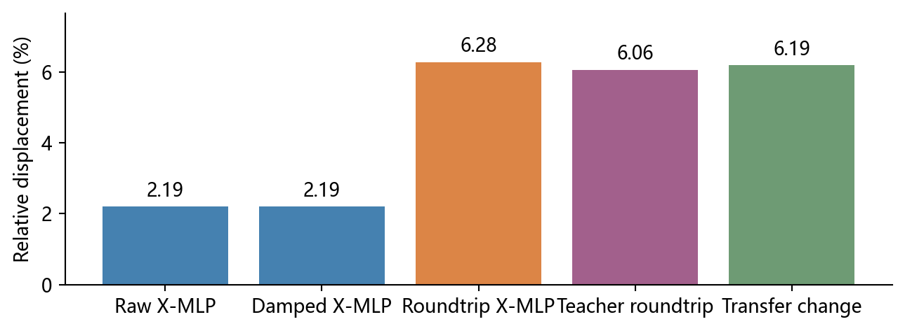
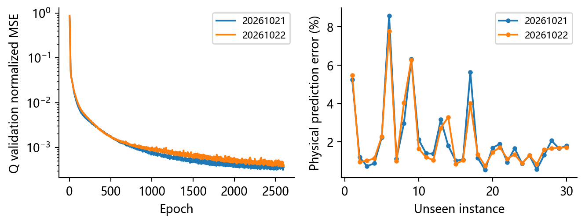
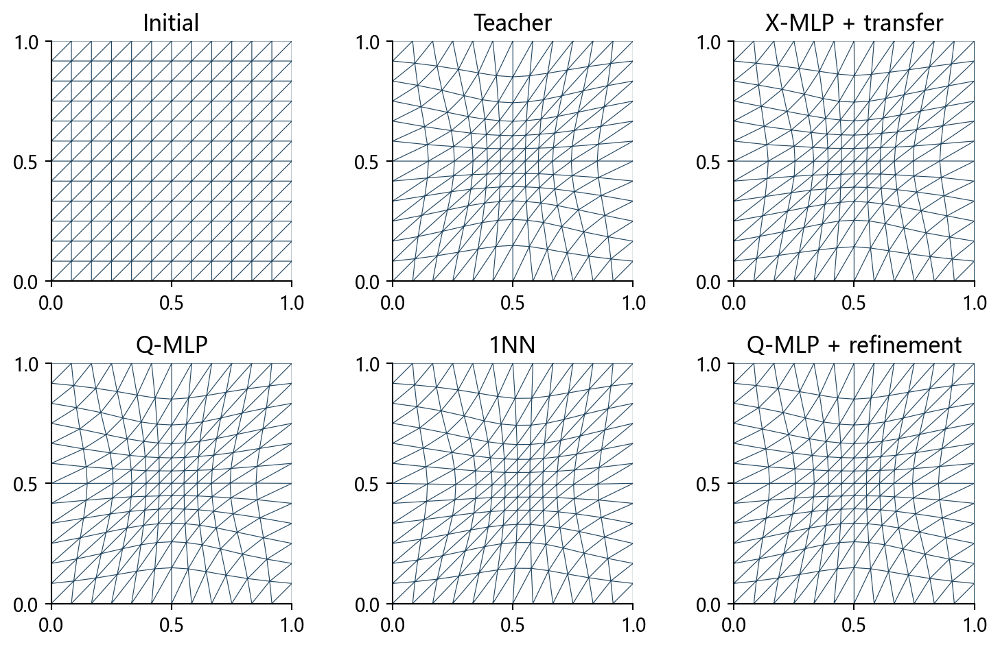
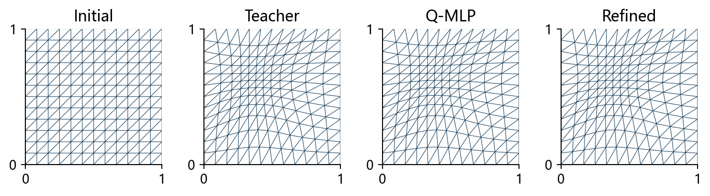
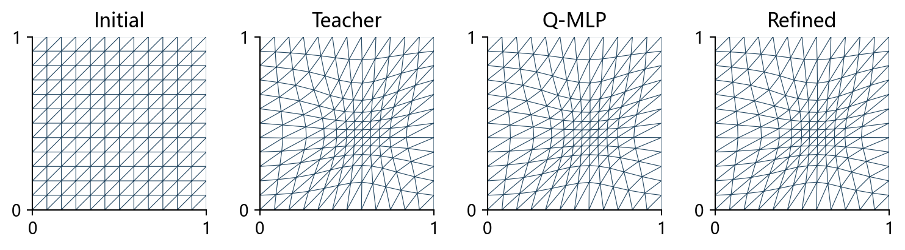
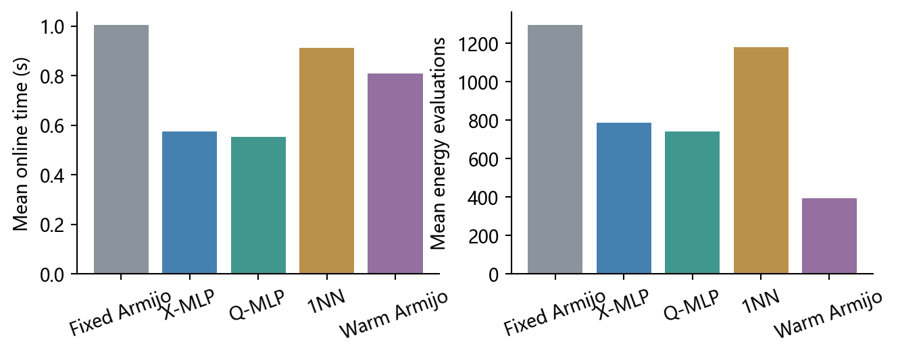

# 基于多层感知机的二维变分自适应网格预测与数值实验

作者：________　学号：________　课程：机器学习课程设计

**摘要：** 本文研究固定拓扑二维变分网格的参数化预测。针对物理节点预测转为优化初值时的误差，分离网络输出、几何退缩和离散坐标往返。精确教师物理网格的往返误差均值为6.06%，解释了物理预测误差由2.19%增至6.28%的现象。复用200个真实教师实例，以相同小型MLP改为监督计算节点位移，并与物理预测、训练集最近邻、两种传统Armijo策略比较。30个测试实例中，Q模型初始化物理误差为2.15%，精修后为6.06e-05，相对规则初值基线加速1.82倍。达到共同阈值的方法中，Q-MLP+精修平均耗时最短。Q-MLP耗时为1NN的0.608倍、为传统沿用步长方法的0.685倍。

**关键词：** 变分网格；多层感知机；计算坐标；插值误差；初值预测

## 1 引言

变分自适应网格通过优化节点坐标，使固定数量的节点响应给定度量。传统方法每次从规则网格开始时，重复相近参数场的优化可能产生可利用的冗余。监督学习可近似参数到参考终点的映射，但网络输出必须与数值求解器的状态语义一致。若仅比较物理图形而不检查状态转换，误差与效率可能被误判。

本文选择固定方形区域和四参数高斯度量，以已有变分求解器产生教师。已有网格学习研究表明学习网格移动是可行方向[2]，本课程实验采用可复现的小型全连接网络，考察坐标表示、插值和简单对照对结果的影响。研究问题是：物理预测误差为何在接入求解器后增大；直接计算坐标监督能否改善；相对于简单传统方法是否仍有实际收益。

## 2 变分问题与坐标接口

区域为 $[0,1]^2$，每轴12个方格，共169个节点、121个内部节点及288个三角形。初始物理网格 $X_0$ 与规则参考网格 $Q_0$ 数值相同，计算状态Q与重建物理网格X含义不同。度量在初始单元中心冻结：

$$
M_\mu(x,y)=\left[1+A\exp\left(-\frac{(x-c_x)^2+(y-c_y)^2}{\sigma^2}\right)\right]I_2.
$$

设 $J_K=B_K(Q)E_K(X_0)^{-1}$，采用冻结物理网格上的离散Winslow能量[1]：

$$
I_h(Q;\mu)=\sum_K |K(X_0)|\,\operatorname{tr}\left(J_KM_K^{-1}J_K^T\right).
$$

本实现省略常数因子1/2。梯度对Q求导，边界梯度为零。传统教师求得 $Q_T$ 后，以分片线性逆映射在参考节点处求值得到 $X_T=R(Q_T)$。所有能量比较均使用相应计算状态，物理节点不能直接送入能量接口。

<!-- pagebreak -->

## 3 离散坐标往返的误差诊断

对物理预测P，原流程先沿 $P-X_0$ 作几何退缩得到 $P_{safe}$，再插值得到计算初值 $C(P_{safe})$，最后重建为 $R(C(P_{safe}))$。R与C在不同三角剖分上重新采样，其离散组合一般不是恒等算子。通过精确教师输入可将此误差与网络拟合能力分离。

统一使用内部节点移动量 $D_T=\|X_T-X_0\|_\mathcal I$ 作分母，定义 $e_X=\|X-X_T\|_\mathcal I/D_T$。计算坐标往返误差另以 $\|Q_T-Q_0\|_\mathcal I$ 归一化。

|量|测试均值/%|
|---|---|
|原始物理预测误差|2.195|
|仅几何退缩后的误差|2.195|
|往返后的预测误差|6.280|
|精确教师物理网格的往返误差|6.060|
|教师计算坐标的往返误差|6.062|
|预测往返引入的变化量|6.189|

测试及展示共33个实例均未触发物理位移退缩，原始与仅退缩误差完全相同。教师自身也出现约6.06%的往返误差，表明额外误差主要来自离散插值。原始2.19%的物理预测仍是网络拟合精度的有效量；6.28%评价的是接入求解器后的物理初值。

令 $a=(P_{safe}-X_T)/D_T$、$b=(R(C(P_{safe}))-P_{safe})/D_T$，有

$$
\|a+b\|^2=\|a\|^2+\|b\|^2+2a^Tb.
$$

逐实例等式残差均值为3.97e-19，交叉项均值为-4.893e-04。该向量关系解释为何不能以两种平均误差之差代替插值变化量。教师状态与往返状态的能量均值分别为1.34915424和1.34995801；往返状态仍合法，但不再等于教师终点。

<!-- pagebreak -->

## 4 数据、学习与比较方法

复用200个随机参数教师及3个预先固定展示实例，不增加教师求解。参数范围为 $c_x,c_y\in[0.30,0.70]$、$A\in[2,8]$、$\sigma\in[0.18,0.30]$。随机实例整体划分为140个训练、30个验证、30个测试；展示参数不参与训练和模型选择。

X模型学习内部 $\Delta X=X_T-X_0$；Q模型学习内部 $\Delta Q=Q_T-Q_0$。两者均采用 $4\to64\to64\to242$、Tanh、20210个参数，输入按训练集均值及标准差归一化，标签除以各自训练集位移分量全局RMS。损失为归一化分量MSE：

$$
L(\theta)=\frac{1}{242N}\sum_{j=1}^N
\left\|f_\theta(\widetilde\mu_j)-\frac{(\Delta Q_T)_j}{s_Q}\right\|_2^2.
$$

Adam学习率0.001、权重衰减 $10^{-6}$、批量32，最多2600轮；验证连续200轮无改善即停止，取最佳验证权重。主种子固定20261021，辅助种子20261022只用于波动检查。输入统计与输出缩放均不读取测试标签。Q预测沿 $Q_0$ 到预测状态退缩，检查Q及R(Q)有限、边界固定、位于区域内、面积大于 $10^{-10}$，失败则回退Q0。

|Q训练种子|最佳轮次|验证坐标MSE|测试物理误差/%|训练时间/s|
|---|---|---|---|---|
|20261021|2591|7.007e-07|2.147|26.10|
|20261022|2567|8.367e-07|2.110|25.89|

比较方法为：B0规则初值、每轮从1提议Armijo；B1原X模型经坐标转换后精修；B2直接Q模型后精修；B3标准化参数空间中训练集1近邻的Q教师初值后精修；B4规则初值、下一轮沿用上次接受步长。B3只检索140个训练教师，不接触验证或测试教师。B4步长限定在 $[10^{-12},1]$，过小则恢复默认提议。

所有方法使用相同冻结度量、边界、Armijo系数 $10^{-4}$、退缩因子1/2、绝对梯度阈值 $10^{-5}$、2200接受迭代与30000能量评价上限。B0至B3共用原求解器，B4仅改变步长提议策略。物理预测原模型和最佳权重保持不变。

<!-- pagebreak -->

## 5 三个代表性数值算例

### 5.1 中心局部加密

参数为 $\mu=(0.50,0.50,5.0,0.24)$。X模型转换后误差为6.516%，Q模型重建误差为0.565%，最近邻误差为18.297%。Q模型精修后误差为6.97e-05，接受迭代144次，在线平均0.8537秒。

图中比较初始、教师、X模型转换后、Q模型、最近邻与Q模型精修后的物理网格。直接Q监督保留计算状态的含义；物理输出仍由原重建函数产生，因此图形与精修初值对应同一状态。局部节点聚集只是可视化依据，精度取全部内部节点的归一化误差。

|算例|X初始化/%|Q初始化/%|1NN初始化/%|Q精修误差|
|---|---|---|---|---|
|center|6.516|0.565|18.297|6.97e-05|
|shifted|6.267|0.936|18.703|1.71e-05|
|strength|7.069|1.003|28.027|7.88e-05|

三个算例分别检验局部峰值位于中心、峰值偏移、强度及宽度改变，均位于给定参数区间内。展示实例不单独训练网络或改变阈值。各方法完整节点数组、初始及最终Q、最小面积、能量和逐迭代历史随实验保存。

<!-- pagebreak -->

### 5.2 偏心与较强局部加密

参数为 $\mu=(0.36,0.64,5.0,0.24)$。X模型转换后误差为6.267%，Q模型重建误差为0.936%，最近邻误差为18.703%。Q模型精修后误差为1.71e-05，接受迭代211次，在线平均0.9585秒。

参数为 $\mu=(0.58,0.43,7.5,0.19)$。X模型转换后误差为7.069%，Q模型重建误差为1.003%，最近邻误差为28.027%。Q模型精修后误差为7.88e-05，接受迭代165次，在线平均0.8477秒。

<!-- pagebreak -->

## 6 独立测试的精度与计算成本

以下为30个测试实例均值。初始能量相对差为 $(I_h(Q)-I_h(Q_T))/|I_h(Q_T)|$。
所有预测误差均评价实际进入精修的物理网格R(Q)，B1原始物理预测误差另列于诊断。B4从规则网格出发，因而初始化误差为1。

|方法|初始化误差/%|最终误差|初始能量相对差|收敛数|
|---|---|---|---|---|
|B0|100.000|0.00e+00|6.40e-02|30/30|
|B1|6.280|4.24e-05|6.45e-04|30/30|
|B2|2.147|6.06e-05|8.85e-05|30/30|
|B3|23.416|5.66e-05|4.52e-03|30/30|
|B4|100.000|2.74e-05|6.40e-02|30/30|

|方法|接受迭代|能量评价|回溯次数|在线时间/s|相对B0加速|
|---|---|---|---|---|---|
|B0|345.0|1296.9|963.9|1.0046|1.00|
|B1|205.7|786.6|580.0|0.5744|1.75|
|B2|193.3|739.8|545.5|0.5532|1.82|
|B3|312.0|1182.0|870.1|0.9105|1.10|
|B4|389.6|392.7|3.0|0.8078|1.24|

模型和最近邻字典在计时前预加载，CPU单线程，每实例每方法重复三次，按实例与重复次数交替正反执行顺序。计时从问题对象建立开始，包含参数归一化、推理或近邻检索、几何检查、重建及精修；不含磁盘读写、加载、指标计算和训练。timings.csv保存495次运行，metrics.csv保存165组状态与同一实例三次耗时的样本标准差。表中均值基于全部30个测试参数，不选择速度较快的个例。

直接计算坐标监督使初始化物理误差由6.28%降至2.15%，完整在线流程相对B0加速1.82倍。达到共同阈值的方法中，Q-MLP+精修平均耗时最短。Q-MLP耗时为1NN的0.608倍、为传统沿用步长方法的0.685倍。

本次共165组最终状态中165组几何合法，未收敛组数0。B1至B3初始化最小退缩系数为1.000。成功率与最终梯度均保存，不用未达精度的终止时间证明加速。能量评价数反映算法工作量，在线时间还包含重建等实际开销，二者不能互相替代。

<!-- pagebreak -->

## 7 讨论与结论

### 7.1 坐标表示与使用价值

精确教师输入的往返误差直接证明：物理坐标到计算坐标的离散转换会改变已经正确的终点，第二轮增加的误差主要由此产生。直接监督Q使用现有教师中已保存的状态，避免了多余的C/R组合，也使网络输出与能量梯度变量一致。X模型原始误差仍应独立报告，不能将其转换后误差解释为训练失败。

直接计算坐标监督使初始化物理误差由6.28%降至2.15%，完整在线流程相对B0加速1.82倍。达到共同阈值的方法中，Q-MLP+精修平均耗时最短。Q-MLP耗时为1NN的0.608倍、为传统沿用步长方法的0.685倍。

Q模型相对原X流程的在线均值缩短3.68%，属于小幅改善，三次重复不能据此宣称稳定显著领先。Q重建误差2.15%与原始X预测2.19%接近，主要改进是避免坐标往返，不是网络拟合精度数量级提升。沿用步长仅需392.7次能量评价，但接受迭代为389.6次，Q精修为193.3次；每次接受还需要物理重建，因此评价数更少没有转化为最短在线时间。

课程设计宜以直接计算坐标预测为主线，并保留最近邻和沿用步长对照。其价值由预测精度、达到同一停止阈值的在线成本与离线摊销共同界定。

最近邻不需要拟合网络，因此是衡量小数据参数回归必要性的直接对照。沿用上次接受步长不需要教师数据，其收益来自减少回溯，不能归为初值预测收益。两类对照分别回答“学习是否优于简单查找”和“收益是否也可由廉价求解策略获得”。本实验据实比较完整在线流程，不将模型推理时间单独作为最终加速。

### 7.2 离线成本与限制

已有203个教师求解累计227.38秒，主Q模型训练26.10秒。若这些教师为新任务专门产生，以B0与B2本次在线均值差粗算，摊平教师与主训练成本约需562次同分布调用。若教师已供其他任务使用，只需计入新增训练成本。辅助种子的训练不属于主模型部署所需成本。

实验限于固定拓扑、分辨率、单高斯冻结度量和参数区间；未测跨分辨率、复杂边界、分布外或PDE解误差。几何合法率和达到教师精度不能直接等同于PDE精度改善。计时依赖本机负载，三次重复用于记录同一实例的波动；测试实例间的标准差另保存在aggregate.csv。网页构建与资源一致性检查不替代浏览器视觉与键盘验收，实际状态见README。

### 7.3 结论

本文通过教师往返实验解释物理预测接入求解器后的误差，使用同规模Q-MLP完成了无需坐标往返的状态预测，并在未见参数与三个代表算例上比较五种方法。核心结论是选择与优化变量一致的监督表示，并以最近邻及传统步长策略界定机器学习收益。该结果支持在当前参数族内进行可复现的课程比较实验。

## 参考文献

[1] Huang W., Kamenski L., Russell R. D. A comparative numerical study of meshing functionals for variational mesh adaptation. Journal of Mathematics Study, 2015, 48(2):168–186. DOI:10.4208/jms.v48n2.15.04.

[2] Song W., Zhang M., Wallwork J. G., et al. M2N: Mesh Movement Networks for PDE Solvers. Advances in Neural Information Processing Systems, 35, 2022.
