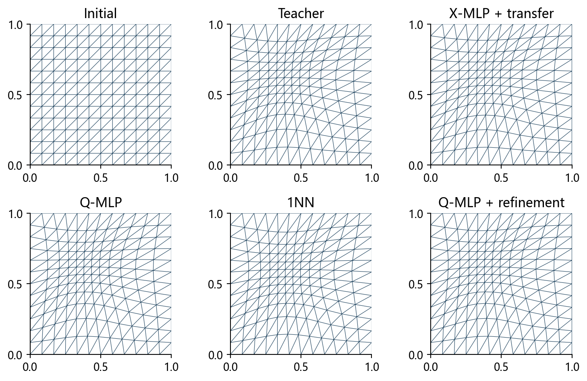
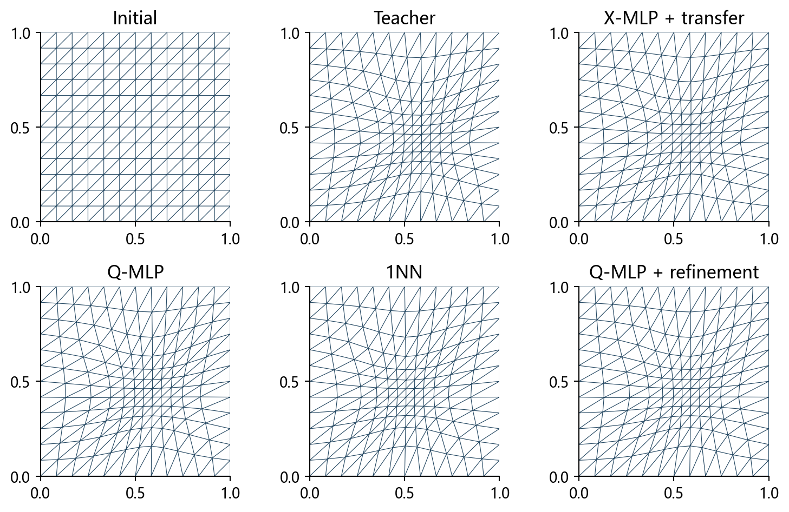

# 二维变分网格：坐标表示与学习初值

## 研究结论

直接计算坐标监督使初始化物理误差由6.28%降至2.15%，完整在线流程相对B0加速1.82倍。达到共同阈值的方法中，Q-MLP+精修平均耗时最短。Q-MLP耗时为1NN的0.608倍、为传统沿用步长方法的0.685倍。

## 问题与教师

固定169节点、288三角形；四参数高斯度量；优化变量为计算节点Q，物理网格为X=R(Q)。200个教师按140/30/30划分，另有三个展示实例。

## 为什么误差从2.19%变成6.28%

精确教师网格往返也产生6.06%误差。33个实例均未发生几何退缩，原因是两次不同三角剖分上的离散重采样不能精确互逆。

|量|测试均值/%|
|---|---|
|原始物理预测误差|2.195|
|仅几何退缩后的误差|2.195|
|往返后的预测误差|6.280|
|精确教师物理网格的往返误差|6.060|
|教师计算坐标的往返误差|6.062|
|预测往返引入的变化量|6.189|

## 直接预测计算坐标

保持4→64→64→242的Tanh网络、训练划分、优化器和预算一致。监督Q_teacher-Q0，只重建一次物理网格，不走物理到计算再到物理的往返。两个固定种子，不用测试结果挑选模型。

|Q训练种子|最佳轮次|验证坐标MSE|测试物理误差/%|训练时间/s|
|---|---|---|---|---|
|20261021|2591|7.007e-07|2.147|26.10|
|20261022|2567|8.367e-07|2.110|25.89|

## 公平对照

B0：规则初值+每轮从1提议Armijo。B1：X-MLP+转换+精修。B2：Q-MLP+精修。B3：140个训练教师中的1近邻+精修。B4：规则初值+沿用上次接受步长。相同梯度阈值1e-5、能量、边界、合法性和预算。

## 算例一：中心加密

参数为 $\mu=(0.50,0.50,5.0,0.24)$。X模型转换后误差为6.516%，Q模型重建误差为0.565%，最近邻误差为18.297%。Q模型精修后误差为6.97e-05，接受迭代144次，在线平均0.8537秒。

## 算例二：加密位置移动

参数为 $\mu=(0.36,0.64,5.0,0.24)$。X模型转换后误差为6.267%，Q模型重建误差为0.936%，最近邻误差为18.703%。Q模型精修后误差为1.71e-05，接受迭代211次，在线平均0.9585秒。

## 算例三：强度与宽度变化

参数为 $\mu=(0.58,0.43,7.5,0.19)$。X模型转换后误差为7.069%，Q模型重建误差为1.003%，最近邻误差为28.027%。Q模型精修后误差为7.88e-05，接受迭代165次，在线平均0.8477秒。

## 全部测试精度

|方法|初始化误差/%|最终误差|初始能量相对差|收敛数|
|---|---|---|---|---|
|B0|100.000|0.00e+00|6.40e-02|30/30|
|B1|6.280|4.24e-05|6.45e-04|30/30|
|B2|2.147|6.06e-05|8.85e-05|30/30|
|B3|23.416|5.66e-05|4.52e-03|30/30|
|B4|100.000|2.74e-05|6.40e-02|30/30|

|算例|X初始化/%|Q初始化/%|1NN初始化/%|Q精修误差|
|---|---|---|---|---|
|center|6.516|0.565|18.297|6.97e-05|
|shifted|6.267|0.936|18.703|1.71e-05|
|strength|7.069|1.003|28.027|7.88e-05|

## 在线成本

|方法|接受迭代|能量评价|回溯次数|在线时间/s|相对B0加速|
|---|---|---|---|---|---|
|B0|345.0|1296.9|963.9|1.0046|1.00|
|B1|205.7|786.6|580.0|0.5744|1.75|
|B2|193.3|739.8|545.5|0.5532|1.82|
|B3|312.0|1182.0|870.1|0.9105|1.10|
|B4|389.6|392.7|3.0|0.8078|1.24|

30个测试+3个展示，每方法三次配对计时，共495次运行。包含问题建立、预测/查找、检查、重建与精修，不含预加载和离线成本。

## 使用价值与限制

直接计算坐标监督使初始化物理误差由6.28%降至2.15%，完整在线流程相对B0加速1.82倍。达到共同阈值的方法中，Q-MLP+精修平均耗时最短。Q-MLP耗时为1NN的0.608倍、为传统沿用步长方法的0.685倍。

Q模型相对原X流程的在线均值缩短3.68%，属于小幅改善，三次重复不能据此宣称稳定显著领先。Q重建误差2.15%与原始X预测2.19%接近，主要改进是避免坐标往返，不是网络拟合精度数量级提升。沿用步长仅需392.7次能量评价，但接受迭代为389.6次，Q精修为193.3次；每次接受还需要物理重建，因此评价数更少没有转化为最短在线时间。

课程设计宜以直接计算坐标预测为主线，并保留最近邻和沿用步长对照。其价值由预测精度、达到同一停止阈值的在线成本与离线摊销共同界定。

专门生成教师并训练主模型约需253.48秒，按本次B0与B2均值差约562次调用摊平。固定拓扑、单高斯、区间内结论；没有PDE误差或跨分辨率结论。

## 参考文献

Huang, Kamenski, Russell. A comparative numerical study of meshing functionals for variational mesh adaptation. 2015.

Song et al. M2N: Mesh Movement Networks for PDE Solvers. NeurIPS 2022.
