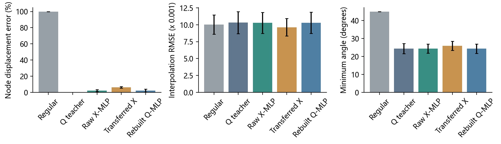
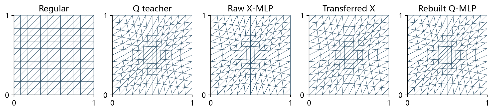
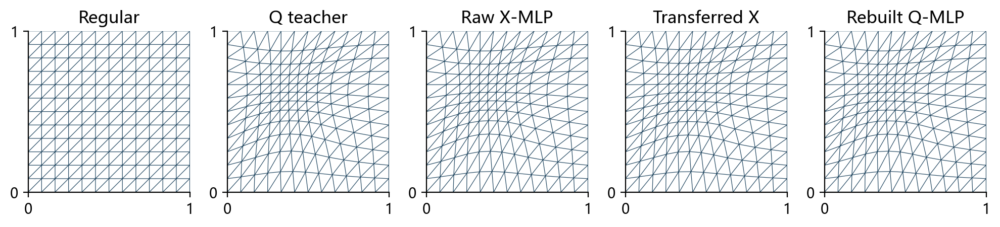
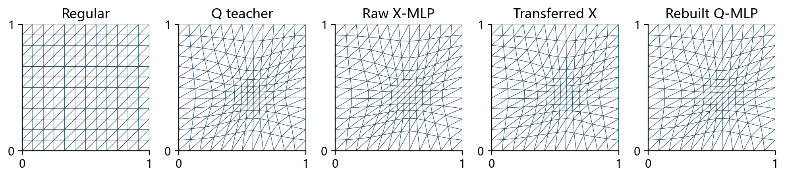
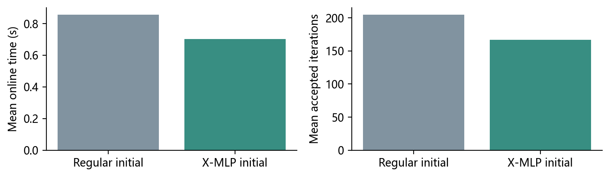
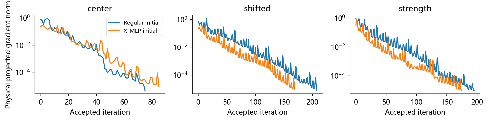

# 直接物理网格预测与优化

## 核心发现（约40秒）

直接X预测在33个未见实例上均合法且无需退缩，测试节点误差为2.19%，与Q模型的2.15%接近。两者插值RMSE分别为0.010280和0.010285；直接X相对规则网格的平均RMSE增加2.52%。

独立物理目标下，规则初值与X模型初值均达到共同梯度阈值。平均接受迭代由205.1降至167.1，完整在线时间由0.858秒降至0.702秒，均值比加速1.22倍。物理精修后RMSE为0.009347，较规则网格降低6.78%。

## 为什么直接使用X（约40秒）

旧X模型已经预测物理节点，新的实验直接使用其输出。Q模型预测计算节点后需要一次物理重建；原X模型进入Q求解器还需离散往返。本轮把这些物理网格分开评价，并使用独立的解析函数插值指标。

## 固定数据与评价（约40秒）

已有200个教师按140/30/30拆分，另有三个展示实例；169节点、288三角形。网络与教师均不重训。所有网格在相同160×160物理采样点上插值同一解析高斯函数，RMSE只是插值误差。

## 直接物理预测是否足够好（约60秒）

|物理网格|节点误差/%|最小角/度|最差质量q|RMSE×1000|
|---|---|---|---|---|
|规则网格|100.000|45.00 ± 0.00|0.866|10.028 ± 1.424|
|旧Q教师物理网格|0.000|24.36 ± 2.80|0.601|10.326 ± 1.634|
|X模型直接输出|2.195|24.38 ± 2.57|0.604|10.280 ± 1.563|
|X模型经坐标往返|6.280|25.92 ± 2.53|0.622|9.635 ± 1.287|
|Q模型一次重建|2.147|24.31 ± 2.58|0.601|10.285 ± 1.572|

原始X与Q重建的插值精度接近，但都略差于规则网格。度量按高斯函数值设定，并非为插值最优设计；接近教师不等于功能误差更低。

## 三个算例（约60秒）

|算例|规则RMSE|原始X RMSE|Q重建RMSE|物理精修RMSE|同目标加速|
|---|---|---|---|---|---|
|center|0.00971|0.01080|0.01085|0.00944|0.87|
|shifted|0.00959|0.01007|0.01009|0.00922|1.34|
|strength|0.01211|0.01288|0.01297|0.01122|1.27|

## 能否直接优化X（约60秒）

固定参考边矩阵，令 $J=\widehat E E(X)^{-1}$。采用Huang均匀分布/对齐能量族，d=2、p=2、theta=1/3，面积、逆Jacobian和重心度量全部随X变化。

$$
E_{\rm phys}(X)=\sum_K |K(X)|m_K(X)\left[
\frac13\left(\frac{\|J_K(X)\|_F^2}{m_K(X)}\right)^2+
\frac43\left(\frac{\det J_K(X)}{m_K(X)}\right)^2\right].
$$

完整自动微分通过方向差分；固定边界、正面积、BB步长提议和单调Armijo回溯。该目标与旧Q目标不同。

## 同目标初值比较（约60秒）

|物理目标的初值|接受迭代|能量评价|在线时间/s|收敛数|
|---|---|---|---|---|
|规则网格|205.1|591.6|0.858 ± 0.294|30/30|
|X模型输出|167.1|487.8|0.702 ± 0.262|30/30|

|初值|初始E_phys|终点E_phys|终点梯度范数|终点插值RMSE|
|---|---|---|---|---|
|规则网格|1.91182496|1.69650846|8.84e-06|0.009347|
|X模型输出|1.70722083|1.69650846|8.88e-06|0.009347|

MLP初值在26/30个测试实例上更快；两个终点最大相对能量差3.99e-11。中心展示例可能不加速，全部个例与重复计时保留。

## 最终方案与限制（约50秒）

课程设计可保留“直接物理预测作为廉价近似与物理优化初值”的方案，以独立插值评测和同目标精修为核心。单独的原始X预测适合快速逼近教师，本次插值指标不支持把它作为无需后处理的最终优胜网格；物理精修的收益温和，需计入离线成本。

专门产生教师并训练需约254.03秒，按本轮同目标均值差约1634次调用摊平。固定拓扑、单高斯、区间内结论；没有PDE精度结论，不跨目标比较加速。

## 参考文献

Huang, Kamenski, Russell. A comparative numerical study of meshing functionals for variational mesh adaptation. 2015.

Song et al. M2N: Mesh Movement Networks for PDE Solvers. NeurIPS 2022.

Barzilai, Borwein. Two-Point Step Size Gradient Methods. 1988.
