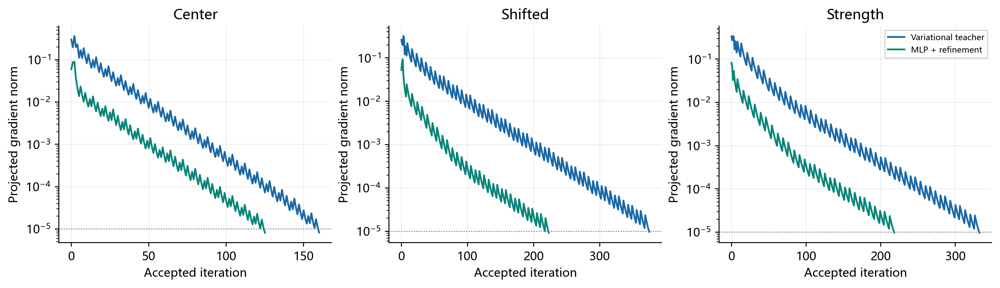

# 基于多层感知机的二维变分自适应网格预测与数值实验

作者：________　学号：________　课程：机器学习课程设计

**摘要：** 本文以传统变分网格为教师，研究固定拓扑二维网格的快速预测。小型MLP以四个高斯度量参数为输入，直接预测内部物理节点位移，并结合合法性检查、坐标状态转换及同目标精修。200个独立实例按140/30/30划分，另设三个展示算例。测试原始预测平均相对误差为2.19%，状态转换后为6.28%，网格全部合法。精修后误差降至4.24e-05，包含预测与预处理的在线流程平均耗时为传统方法的0.614倍。结果显示该问题族内存在预测与初值收益，同时需计入插值误差和离线成本。

**关键词：** 自适应网格；多层感知机；变分方法；位移预测；监督学习

## 1 引言

移动网格在不增加节点数量、不改变连接关系的条件下调整节点位置，使网格向指定区域集中。变分方法通过最小化网格泛函确定坐标映射，数值结果取决于度量、边界和离散方式[1]。对于需要反复处理相近参数场的问题，传统优化每次都从规则网格出发，可能重复执行相似的坐标调整。本课程设计考察能否学习参数与优化后物理节点之间的关系，并将预测用于直接近似或优化初值。

M2N研究了基于传统参考网格的监督网格移动[2]；UGM2N从无监督几何目标研究网格生成与泛化[3]。本文采用固定方形区域、固定顶点编号和一个小型全连接网络，教师为本地已有的Winslow变分网格实现。目标是验证小规模参数族内的可行性、误差和成本，而非复现上述完整网络或求解系统。

## 2 数学与学习方法

### 2.1 冻结物理网格上的变分教师

初始物理节点为 $X_0$，规则参考节点为 $\widehat Q$，计算节点为 $Q$。三者共享连接数组。单元边矩阵 $E_K=E_K(X_0)$、$B_K=B_K(Q)$，Jacobian 为 $J_K=B_KE_K^{-1}$。本实现采用

$$
I_h(Q;\mu)=\sum_K |K(X_0)|\,\operatorname{tr}(J_K M_K(\mu)^{-1}J_K^T).
$$

这是[1]式(6)的几何离散形式，省略常数因子 $1/2$。物理面积和度量在内迭代中冻结，梯度对计算节点求导。设 $C_K=E_K^{-1}M_K^{-1}E_K^{-T}$，对边矩阵的导数为 $2|K|B_KC_K$，再按顶点装配并将边界梯度投影为零。教师最终物理网格为 $X_T=R(Q_T)$，其中 $R$ 是原有分片线性逆映射在参考节点处的求值；训练标签取 $X_T-X_0$ 的内部节点部分。

<!-- pagebreak -->

### 2.2 参数族、网络及损失

区域为 $[0,1]^2$，每轴12个方格，固定剖分为288个三角形，共169个节点，其中内部121个。所有样本使用相同的规则初始网格，输入仅为 $\mu=(c_x,c_y,A,\sigma)$。度量在初始物理单元中心评价：

$$
M_\mu(x,y)=\left[1+A\exp\left(-\frac{(x-c_x)^2+(y-c_y)^2}{\sigma^2}\right)\right]I_2.
$$

两特征值均大于等于1。采样范围为 $c_x,c_y\in[0.30,0.70]$、$A\in[2,8]$、$\sigma\in[0.18,0.30]$。MLP结构为 $4\to64\to64\to242$，两隐层使用Tanh，共20210个参数。输入按训练集均值和标准差标准化，位移除以训练集位移分量的全局均方根。训练损失为

$$
L=\frac{1}{2N_{\rm int}}\sum_{i\in\mathcal I}\|\Delta X_i^{\rm pred}-\Delta X_i^T\|_2^2.
$$

实际训练对归一化位移计算上述MSE，曲线同时还原原坐标尺度。使用Adam、学习率0.001、批量32、权重衰减 $10^{-6}$，最多2600个epoch；连续200个epoch验证误差未改善即早停，保留最佳验证权重。边界位移不由网络预测，直接复制初始边界。训练与模型选择均不读取测试标签。

### 2.3 安全预测与一致状态精修

网络输出物理位移。先从 $X_0$ 沿该位移取 $\tau=1,1/2,\ldots$ 的候选，逐一检查有限值、固定边界、区域范围和全部三角形面积大于 $10^{-10}$。若不能通过则回退到 $X_0$，原始非法率、退缩次数和回退率均保留。

精修需要计算坐标初值。对合法物理候选 $P$，用其三角剖分上的“物理节点到参考节点”线性映射在固定 $X_0$ 上插值，定义 $Q_P=C(P)$；再计算 $X_P=R(Q_P)$。对 $Q_P$、$X_P$ 均检查合法性，不满足则继续位移退缩。四状态比较中的“MLP安全预测”指这个与计算状态一致的 $X_P$，同时保存转换前 $P$ 并报告转换误差。该插值往返不是精确求逆，也没有使用教师坐标修正预测。

传统与精修均最小化同一 $I_h(Q;\mu)$，使用固定初值1的Armijo回溯，退缩因子1/2、充分下降系数 $10^{-4}$。接受计算候选后还检查重建物理网格。两者共同采用绝对停止条件 $\|g\|_2\le10^{-5}$，最多2200次接受迭代、30000次能量评价。精修从 $Q_P$ 出发，不把物理节点直接放入计算节点接口。

<!-- pagebreak -->

## 3 数据与数值实验

### 3.1 教师核验与实例划分

沿用的能量、梯度和逆映射具有单元手算、方向差分、恒等映射及网格合法性测试。本次新增五项检查覆盖高斯问题族的梯度、固定拓扑、初值转换、非法位移退缩和非有限预测回退。先运行24个随机教师实例，24/24收敛、24/24合法，物理位移非零且标签随参数变化，再扩充正式数据。

正式数据含200个随机参数实例及三个固定展示实例，共203次独立教师求解，其中203次通过收敛和几何检查，失败数0，全部结果均保存。随机实例按140/30/30划分训练、验证和测试；同一参数实例整体进入一个集合。展示参数在训练前写入配置，不用于早停或模型选择。随机种子20261021，配置及划分随数据归档。

### 3.2 训练与非平凡移动基线

本次实际训练2600个epoch，最佳验证epoch为2589。验证坐标分量MSE为9.343e-07，不移动网格的对应MSE为2.333e-03。教师标签是终点物理位移，迭代中间步骤没有被当作额外独立样本。神经网络只学习固定分辨率、固定拓扑下的参数映射。

运行环境为Windows、Intel Core Ultra 7 155H、Python 3.13.2、NumPy 2.3.4、PyTorch 2.13.0+cu126。训练及评测统一CPU单线程。训练时间26.65秒，全部教师求解累计227.38秒；二者作为离线成本单列。

<!-- pagebreak -->

### 3.3 算例一：中心局部加密

参数为 $\mu=(0.50,0.50,5.0,0.24)$。安全预测相对位移误差为6.52%，精修后为2.56e-05。四张图使用相同坐标范围、节点编号及连通关系，直接比较中心聚集的形状。

### 3.4 算例二：加密区域移动

参数为 $\mu=(0.36,0.64,5.0,0.24)$。安全预测相对位移误差为6.27%，精修后为9.57e-06。该例只改变输入参数，未为偏心位置另行训练网络或调整安全阈值。预测是否贴近教师由全部内部节点误差评价，不以图形相似代替数值误差。

<!-- pagebreak -->

### 3.5 算例三：强度与作用范围变化

参数为 $\mu=(0.58,0.43,7.5,0.19)$，仍位于训练参数区间内。安全预测相对误差为7.07%，精修后为3.40e-05；这检验区间内部响应，不作为分布外泛化证据。

### 3.6 独立测试与能量

相对位移误差定义为 $e_X=\|X-X_T\|_{\mathcal I}/\max(\|X_T-X_0\|_{\mathcal I},10^{-14})$，不移动基线为1。下表为30个独立测试实例的算术均值，能量相对差为 $(I_h-I_h(Q_T))/|I_h(Q_T)|$；能量均评价对应计算状态 $Q$，不是把物理数组直接代入梯度接口。

表1　测试集四状态比较；预测行仅包含生成开销，精修行包含全部在线流程

|状态|位移相对误差|能量相对差|最小面积均值|评价次数|在线时间/s|
|---|---:|---:|---:|---:|---:|
|初始网格|1.00000|6.40e-02|3.472e-03|0.0|0.00000|
|传统参考|0.00000|0.00e+00|1.384e-03|1296.9|1.23442|
|MLP安全预测|0.06280|6.45e-04|1.447e-03|0.0|0.02364|
|MLP后精修|0.00004|-2.22e-12|1.384e-03|786.6|0.75769|

表2　三个展示实例的同一冻结状态能量 $I_h(Q)$

|算例|初始状态|传统状态|预测状态|精修状态|
|---|---:|---:|---:|---:|
|中心加密|1.36223151|1.26381962|1.26460948|1.26381962|
|偏心加密|1.40190903|1.31760244|1.31840516|1.31760244|
|强度与宽度变化|1.51695880|1.39969210|1.40097827|1.39969210|

原始MLP物理输出的平均相对位移误差为2.19%，仅几何退缩后为2.19%，再经状态转换后为6.28%。原始预测合法率为100.0%，安全处理后合法率为100.0%，回退率为0.0%。物理候选经状态转换后的相对变化量在测试集中最大为7.35%；这部分离散插值误差与网络误差分开记录，转换前后数据均可复核。

<!-- pagebreak -->

## 4 精修成本与结果讨论

表3　三个展示实例的精度与成本；时间为三次配对运行均值

|算例|预测误差|精修误差|传统迭代|精修迭代|传统时间/s|混合时间/s|
|---|---:|---:|---:|---:|---:|---:|
|中心加密|0.0652|2.56e-05|160|125|0.7168|0.3985|
|偏心加密|0.0627|9.57e-06|375|223|1.3274|0.7561|
|强度与宽度变化|0.0707|3.40e-05|332|218|1.0674|0.9436|

独立测试集传统求解平均1.2344秒，直接预测加安全/状态处理平均0.0236秒，完整混合流程平均0.7577秒。混合方法的平均在线耗时为传统方法的0.614倍，按均值比计算的加速比为1.63。 评估含30个随机测试和三个展示实例，精修中33/33次达到共同阈值。单步与累计能量评价计数、回溯次数及梯度范数均保存于逐步记录。

<!-- pagebreak -->

### 4.1 计时与离线摊销

模型预加载后，每次在线计时包含度量及能量对象建立、输入归一化、MLP推理、位移安全退缩、两次插值状态转换和传统精修，不含模型加载、文件读写、指标汇总和离线训练。传统基线包含同样的问题对象建立与优化。每实例重复三次并交替先后顺序。表1的标准差描述测试实例差异，图5误差棒描述同一实例重复计时差异；二者用途不同。

教师与训练离线成本合计约254.03秒。以本次均值差作粗略估算，需要约533次同分布在线调用才能摊平这批教师求解和拟合成本。 该估算依赖本机负载、固定问题族和持续使用场景，不包含未来重新训练或数据整理成本。

### 4.2 局限

本实验仅对固定拓扑、固定分辨率的单高斯正定度量进行同区间预测，不能推断跨网格规模、复杂几何、多峰度量或分布外泛化。MLP监督的是所选传统离散教师的终点，预测误差小不自动意味着PDE误差更小。状态转换为分片线性插值，存在已测量的往返差异；每次候选的正面积和边界检查也不等同于任意网格上的通用非退化定理。

本实现为冻结度量内迭代和显式梯度优化，不包含完整PDE求解或外层度量更新。它没有复现M2N的Monge–Ampère教师或完整网络[2]，也没有实现UGM2N的无监督损失与跨拓扑系统[3]。所有速度、误差和合法率只取自本项目实际运行，不引用文献性能替代实验数据。

## 5 结论

本文以已有变分网格算法产生真实物理网格标签，完成了四参数到242维内部节点位移的小型MLP训练、独立测试及三个四状态可视化算例。独立测试集原始物理预测平均相对位移误差为2.19%，安全/状态转换后为6.28%，精修后为4.24e-05；安全预测合法率为100.0%。混合方法的平均在线耗时为传统方法的0.614倍，按均值比计算的加速比为1.63。

课程实验表明，直接物理位移预测可以作为具有明确误差的近似输出，而同目标精修提供恢复教师精度的途径。实际选择应同时考虑预测偏差、几何合法性、状态转换和训练摊销；在本实验范围之外，需要重新检验上述结论。

## 参考文献

[1] Huang W., Kamenski L., Russell R. D. A comparative numerical study of meshing functionals for variational mesh adaptation. Journal of Mathematics Study, 2015, 48(2):168–186. DOI:10.4208/jms.v48n2.15.04. [原文入口](https://arxiv.org/abs/1503.04709)。

[2] Song W., Zhang M., Wallwork J. G., et al. M2N: Mesh Movement Networks for PDE Solvers. Advances in Neural Information Processing Systems, 35, 2022. DOI:10.52202/068431-0522. [会议原文](https://proceedings.neurips.cc/paper_files/paper/2022/hash/2f88d8061f12abae9d14d376fd69c933-Abstract-Conference.html)。

[3] Wang Z., Chen X., Wang Q., et al. UGM2N: An Unsupervised and Generalizable Mesh Movement Network via M-Uniform Loss. Advances in Neural Information Processing Systems, 38, 2025. DOI:10.52202/085713-1885. [会议原文](https://proceedings.neurips.cc/paper_files/paper/2025/hash/5170d42c38539462236b23e03808068c-Abstract-Conference.html)。
