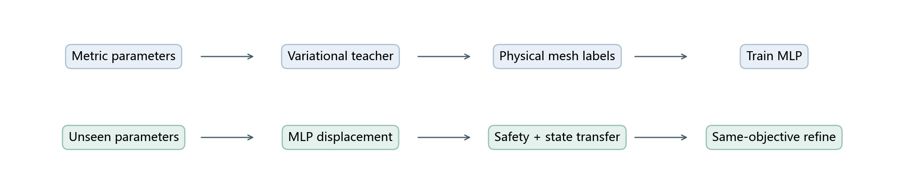
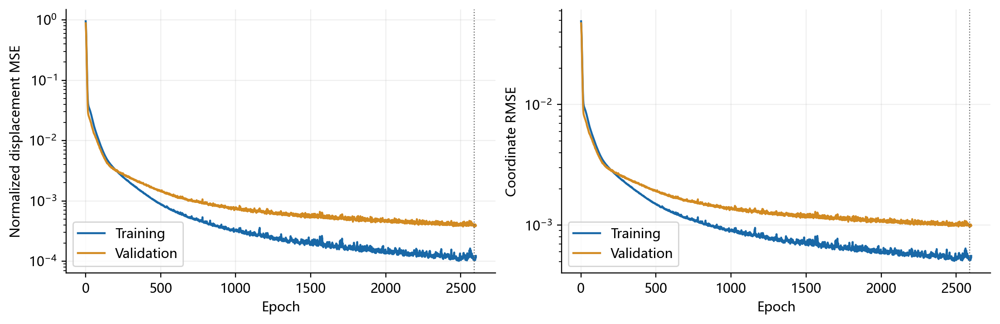
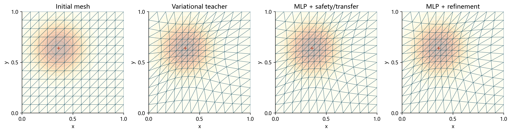
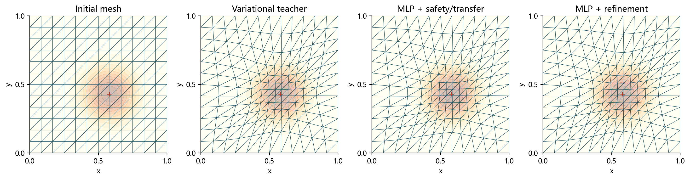
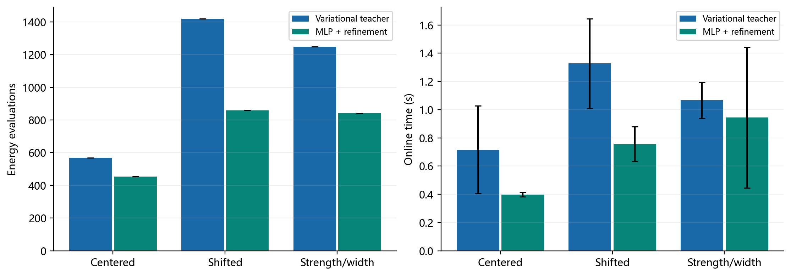

# 多层感知机能否直接预测二维自适应网格？

机器学习课程设计 · 四参数输入 · 物理节点位移预测

## 1 问题：重复优化，能否学习一次后直接预测？

固定169个顶点、288个三角形，改变高斯度量的中心、强度和宽度。我们希望从四个参数预测121个内部物理节点的位移，再检验是否需要精修。独立测试集原始物理预测平均相对位移误差为2.19%，安全/状态转换后为6.28%，精修后为4.24e-05；安全预测合法率为100.0%。混合方法的平均在线耗时为传统方法的0.614倍，按均值比计算的加速比为1.63。

## 2 学习框架：教师、预测与精修

教师优化计算节点 $Q$，最终通过原有逆映射重建物理节点 $X_T$。神经网络标签是物理位移，预测物理数组经过独立状态转换后才能交给原优化器。

$$
\mu=(c_x,c_y,A,\sigma)\ \longrightarrow\ \Delta X_{\mathcal I},
\qquad X_T=R(Q_T).
$$

## 3 方法：小型MLP与共同安全检查

网络 $4\to64\to64\to242$，两个Tanh隐层、Adam、验证集早停，边界直接复制初始网格。用训练集拟合归一化。原始预测不合法时，从规则网格沿位移按 $1,1/2,\ldots$ 退缩，实际检查正面积与区域约束。

$$
I_h(Q)=\sum_K |K(X_0)|\,\operatorname{tr}(B_KE_K^{-1}M_K^{-1}E_K^{-T}B_K^T).
$$

精修使用同一冻结能量与绝对梯度阈值 $10^{-5}$。插值状态转换存在往返误差，相关数值另存，不能把预测物理坐标直接当计算坐标。

## 4 数据：实例隔离，验证非平凡移动

24个教师小样本检查通过后，生成200个独立参数实例，按140/30/30划分；另设三个未见展示实例。教师标签由真实收敛求解产生，完整参数、迭代和失败记录保留。MLP实际训练2600个epoch，最佳验证epoch为2589。

## 5 三个算例：初始、传统、预测、精修

### 中心加密

### 加密区域移动

### 强度与宽度变化

三图参数均在训练区间内，展示组合事先写入配置，未用于调参。底色表示度量标量，红十字是峰值中心；所有图节点、边界、拓扑一致。

## 6 指标：精度、几何和总成本一起看

|状态|位移相对误差|能量相对差|最小面积均值|评价次数|在线时间/s|
|---|---:|---:|---:|---:|---:|
|初始网格|1.00000|6.40e-02|3.472e-03|0.0|0.00000|
|传统参考|0.00000|0.00e+00|1.384e-03|1296.9|1.23442|
|MLP安全预测|0.06280|6.45e-04|1.447e-03|0.0|0.02364|
|MLP后精修|0.00004|-2.22e-12|1.384e-03|786.6|0.75769|

|算例|预测误差|精修误差|传统迭代|精修迭代|传统时间/s|混合时间/s|
|---|---:|---:|---:|---:|---:|---:|
|中心加密|0.0652|2.56e-05|160|125|0.7168|0.3985|
|偏心加密|0.0627|9.57e-06|375|223|1.3274|0.7561|
|强度与宽度变化|0.0707|3.40e-05|332|218|1.0674|0.9436|

原始MLP物理输出平均相对位移误差2.19%，经安全/状态处理后6.28%。原始测试预测合法率100.0%，安全处理后100.0%，回退率0.0%。计时包含推理、安全处理、状态转换和精修；模型加载、教师数据生成与训练为离线成本。

## 7 结论与局限

独立测试集原始物理预测平均相对位移误差为2.19%，安全/状态转换后为6.28%，精修后为4.24e-05；安全预测合法率为100.0%。混合方法的平均在线耗时为传统方法的0.614倍，按均值比计算的加速比为1.63。

固定拓扑、单高斯场、同区间测试；没有跨拓扑、分布外或PDE误差结论。预测是可测误差的近似，精修才与传统终止精度比较。教师来自Winslow能量，未复现M2N或UGM2N的完整系统。

本地打开当前 index.html 可离线汇报；完整论文在 paper/report.pdf，源码和数据均随项目提供。从项目根目录运行 python run_all.py 可完整复现。

## 8 参考文献

[1] Huang W., Kamenski L., Russell R. D. A comparative numerical study of meshing functionals for variational mesh adaptation. Journal of Mathematics Study, 2015, 48(2):168–186. DOI:10.4208/jms.v48n2.15.04. [原文入口](https://arxiv.org/abs/1503.04709)。

[2] Song W., Zhang M., Wallwork J. G., et al. M2N: Mesh Movement Networks for PDE Solvers. Advances in Neural Information Processing Systems, 35, 2022. DOI:10.52202/068431-0522. [会议原文](https://proceedings.neurips.cc/paper_files/paper/2022/hash/2f88d8061f12abae9d14d376fd69c933-Abstract-Conference.html)。

[3] Wang Z., Chen X., Wang Q., et al. UGM2N: An Unsupervised and Generalizable Mesh Movement Network via M-Uniform Loss. Advances in Neural Information Processing Systems, 38, 2025. DOI:10.52202/085713-1885. [会议原文](https://proceedings.neurips.cc/paper_files/paper/2025/hash/5170d42c38539462236b23e03808068c-Abstract-Conference.html)。
