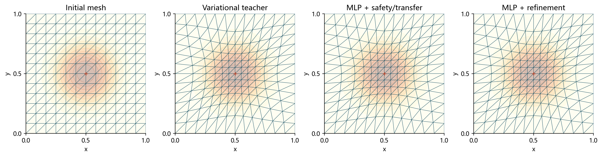

[当前课程项目总览](../README.md) · 本页保留第二轮实验说明及其数据口径。

# 基于多层感知机的二维变分自适应网格预测与数值实验

机器学习课程设计：用真实变分网格教师训练小型MLP，从高斯度量的四个参数预测固定拓扑网格的内部物理节点位移，并比较安全预测与同目标精修。

## 成果入口

- [中文论文PDF](paper/report.pdf)、[Markdown](paper/report.md)、[LaTeX](paper/report.tex)、[离线论文网页](paper/report.html)。
- [课堂汇报网页](presentation/index.html)：双击打开，内嵌公式字体、脚本和真实图像。
- [实测结果](results_summary.md)、[逐实例四状态指标](results/metrics.csv)、[测试集汇总](results/aggregate.csv)。
- [继承与坐标接口审计](project_audit.md)、[完整配置](config.yaml)、[独立实例划分](data/split.json)。

## 项目状态与对照

**当前状态：实验与报告已完成，待本人评估。** 本项目与[随机森林步长预测练手项目](../历史练手/随机森林步长预测/)并列保存，分别保留模型、数据、论文和汇报网页。

原始MLP在30个独立测试实例上的平均相对物理位移误差为2.19%，经安全和状态转移处理后为6.28%，精修后为4.24e-5。全部测试预测合法且无回退。包含推理、预处理及精修的平均在线耗时为0.758秒，传统参考为1.234秒；均值比约1.63。完整成本、重复计时和适用范围见报告及CSV。

GitHub文件页不直接运行HTML。查看汇报时下载presentation/index.html后打开；PDF可以在GitHub文件页阅读。

## 运行流程

完整流水线依次执行：五项数值检查 → 24教师样本检查 → 203个教师实例 → MLP训练 → 未见实例配对评测 → 图表 → 论文PDF → 原生成器汇报网页 → 数值与产物校验。

已生成教师数据会在完整配置和参数一致时复用；失败实例仍保存并单列记录。训练和评测重新执行，耗时随机器负载变化。仅重建图表、论文和网页可使用 run_all.py --documents-only。

## 环境与复现

建议Python 3.13，复用已有CPU可运行的PyTorch；依赖版本见requirements.txt。文档重建需要Node.js 22.12+（建议24）、XeLaTeX/ctex。首次重建网页时，原生成器会准备锁定的前端依赖，需要联网下载；不必安装GPU或完整PDE软件栈。

~~~powershell
cd academic/mlp-mesh-prediction/工程与历轮实验
python -m venv .venv
.\.venv\Scripts\python.exe -m pip install -r requirements.txt
.\.venv\Scripts\python.exe run_all.py
~~~

数值脚本可以单独运行：

~~~powershell
python -m unittest discover -s tests -v
python generate_dataset.py --smoke
python generate_dataset.py
python train.py
python evaluate.py
python make_figures.py
~~~

运行日志写入results/build_logs/；生成ZIP使用 python package_project.py。交付的PDF和HTML无需开发环境即可阅读；HTML可以用PageDown/PageUp、Home/End滚动，保留原网页生成器的主题和打印入口。

## 目录

|位置|内容|
|---|---|
|src/geometry.py、src/variational_mesh.py|已有正确能量、解析梯度及逆映射的原样副本|
|src/common.py、src/teacher.py|继承的固定拓扑、高斯度量、同目标教师与精修接口|
|src/network.py、train.py|小型MLP、训练集归一化、验证早停及最佳权重|
|validate_mesh.py、safe_prediction.py|物理位移退缩、合法性检查及计算状态初始化|
|data/teacher/|每个独立实例的参数、物理标签、计算状态、拓扑、指标及历史|
|data/failures.json|不收敛或几何不合法的教师实例记录|
|results/meshes/、results/histories/|所有未见实例的四状态、原始预测和优化轨迹|
|results/metrics.csv、results/timings.csv|误差、面积、能量、成本及三次配对时间记录|
|models/mlp.pt|最佳验证权重及仅训练集拟合的缩放参数|
|paper/、presentation/|重写的论文、课堂讲稿及离线网页|
|tools/reporting/|已有汇报生成器必要源码，未包含node_modules|
|verify_results.py|独立复核标签、划分、归一化、状态、下降、指标和资源|

## 坐标与能量口径

教师在冻结初始物理网格X0上优化计算节点Q，物理标签是原逆映射重建的X_teacher；MLP预测的是内部物理位移。边界直接复制X0。

物理预测P经位移退缩合法后，用P上的“物理→参考”线性映射在X0处插值得到Q_P，再重建X_prediction=R(Q_P)，保证交给精修的状态与比较网格一致。四状态图中的MLP栏包含这个安全与转移处理。原始MLP输出、仅退缩后的P、对齐后的X_prediction均保存；三者的误差和转移引入的相对变化分别统计。

能量比较写作I_h(Q)，同一mu下使用完全相同的冻结能量。传统与精修共用绝对梯度阈值1e-5、Armijo和面积要求。每次在线时间包含问题建立、推理、退缩、状态转移及精修，不含离线训练、加载模型、读写文件或诊断指标。模型在评测前预加载，CPU单线程；每实例重复三次并交替运行顺序。

## 实测范围与限制

正式随机参数实例140/30/30划分，另有三个预先固定的展示组合，均在给定参数范围内。原始非法率、处理后非法率、回退率、失败求解和全部成本均以实际结果文件为准。没有PDE误差、分布外、跨分辨率或跨拓扑结论；物理/计算状态的离散插值存在往返差异，并单独报告。

论文与网页的数据来自同一CSV/JSON。浏览器实际显示和键盘验收状态记录于results/verification.json；生成及归档校验不能替代浏览器视觉验收。作者、学号保留空白。

[返回课程项目总览](../README.md) · [前期步长预测实验](../历史练手/随机森林步长预测/)
