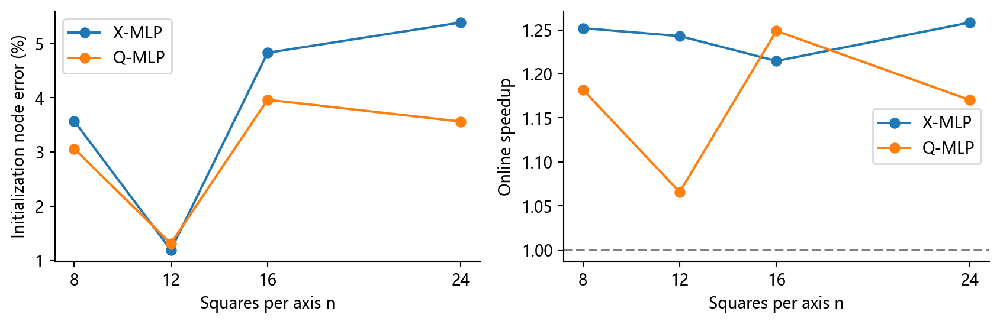
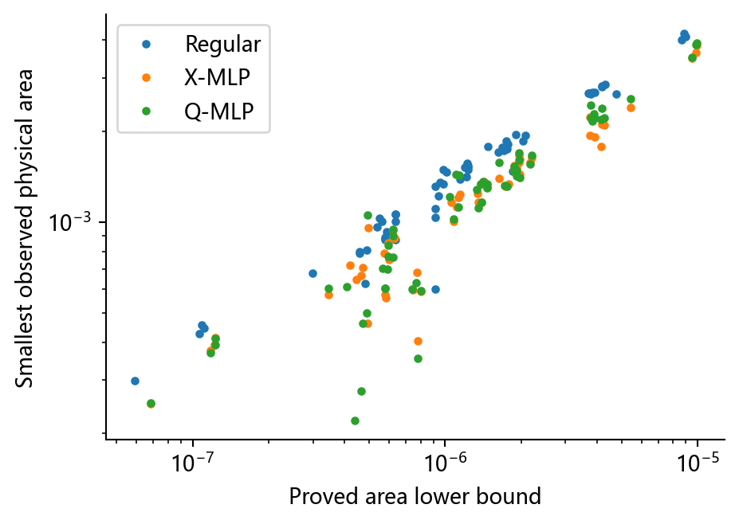

# 泛化、规模迁移与原论文核验

## 核心结论

新同分布样本上X/Q物理初始化误差为1.54%/1.40%，对应同目标平均加速1.20/1.14倍。

分布外窄强峰的X误差升至71.2%，宽弱峰为51.4%；不能把同分布精度推广为外推保证。

网络原生输出固定242维；8/16/24规模的结果使用显式双线性位移场插值，没有重新训练，属于带适配器的迁移。

波前和双峰没有原生输入接口。固定高斯代理初始化在双峰组X加速为0.97倍，没有稳定优势；不能称为网络学会这些外部场。

窄强峰组物理能量下降后，X初始化的插值RMSE反而增加20.3%。能量最小化与插值最小化不是同一目标。

## 数据与实验协议

新增60个评估问题，没有重新训练模型。40个新高斯参数包括16个新同分布、8个中心外推、8个窄强峰和8个宽弱峰；另有12个规模迁移问题、4个正弦波前和4个双峰代理问题。具体参数见results/cases.json，种子20261025。

三种初值都最小化相同物理能量，固定拓扑、边界、梯度阈值1e-5、4000次迭代和40000次能量预算。模型预加载，每问题交替顺序重复三次，保存540次计时。旧冻结Q目标仅生成参考物理坐标，不将其求解时间与新物理目标作同精度比较。

只有两种方法都收敛且终点相对能量差不超过1e-7时才计算成对加速；原始状态、终止原因与完整耗时保留。节点误差分母是当前参考教师的内部移动量；弱加密时分母较小，应同时看results/absolute_errors.csv中的坐标分量RMSE。Q的原始合法率检查其计算输出，进入精修的物理状态另经合法性检查。

## 泛化结果

|测试组|例数|X初始化误差/%|Q初始化误差/%|X同目标加速|Q同目标加速|
|---|---|---|---|---|---|
|新同分布参数|16|1.54|1.40|1.20|1.14|
|中心外推|8|20.47|30.91|1.26|1.35|
|窄峰强加密|8|71.21|73.43|1.11|1.27|
|宽峰弱加密|8|51.41|52.61|1.05|1.07|
|8×8规模迁移|4|3.57|3.06|1.25|1.18|
|16×16规模迁移|4|4.83|3.96|1.21|1.25|
|24×24规模迁移|4|5.39|3.56|1.26|1.17|
|论文波前代理|4|99.86|100.18|1.06|1.06|
|双峰代理|4|136.36|137.25|0.97|1.00|

表中外部场的代理输入固定为(0.5,0.5,5,0.24)。这保留原模型接口，测试高斯形状初始化的迁移，而不是用四参数伪装任意函数的完整编码。不同场可以有完全相同的网络输出。

## 规模测试

网络在12×12方格上训练。规模测试选用四个相同高斯参数，在参考坐标中将13×13节点上的位移做双线性插值，再检查边界、面积与必要退缩。没有直接改变网络输出层，也没有按新规模重新训练。

本次8—24方格范围内可运行，但更细网格上的预测误差没有随有限元分辨率自动收敛到零。结果不能推广到不同拓扑、不同区域或任意分辨率。

## 原论文对应关系

原文为Huang和Kamenski，J. Comput. Phys. 301 (2015):322–337，arXiv:1410.7872v2。已检查用户本地PDF第1、12、13、14页，页脚编号与PDF页码在这些页一致。

Example 4.1的M=I平滑测试采用Huang泛函theta=1/3、p=2，在固定物理网格上优化Q，再重建物理网格。使用自己的正扰动网格、对角三角剖分和Armijo极小化，替代原文的ode15s积分到t=1。

|每轴方格|种子|收敛|剩余扰动比例|最小终点面积|
|---|---|---|---|---|
|12|17|True|4.02e-06|3.472e-03|
|12|29|True|1.00e-05|3.472e-03|
|20|17|True|3.15e-05|1.250e-03|
|20|29|True|3.09e-05|1.250e-03|

四个实例都恢复到接近参考规则网格，支持平滑机制的定性复现；不声称复现原论文轨迹、全部网格连接、计时或所有例题。

Example 4.2原函数为u=tanh(-30[y-1/2-(1/4)sin(2pi x)])。本轮相位零实例使用这一函数，其他三例改变相位；度量改为有界各向同性波带监测函数，而非原文引用的Hessian度量构造。马蹄形区域及三维九球案例未实施，不把本轮算例迁移称为完整论文复现。

## 功能指标与能量目标

|组别|规则RMSE|X初值RMSE|X精修RMSE|
|---|---|---|---|
|新同分布参数|0.009828|0.010112|0.009271|
|中心外推|0.009769|0.008374|0.008454|
|窄峰强加密|0.020584|0.013391|0.016103|
|宽峰弱加密|0.005940|0.005330|0.005396|
|8×8规模迁移|0.020939|0.020009|0.018989|
|16×16规模迁移|0.005466|0.005256|0.005043|
|24×24规模迁移|0.002443|0.002416|0.002271|
|论文波前代理|0.132547|0.140337|0.058920|
|双峰代理|0.024953|0.024736|0.020661|

所有RMSE使用相同160×160物理采样点与解析节点真值。窄强峰中的RMSE反升是实际结果，不能因优化能量下降而删去。初值是否接近旧教师、物理能量是否更低、具体函数插值是否更准，是三个不同问题。

## 数学结论

[数学结论与证明](数学结论与证明.md)给出物理能量的正面积下界、条件Armijo驻点结果、原冻结Q目标的强凸性、误差传递条件和不可普遍排序的反例。

面积界由独立物理目标本身保证，不是MLP独有优势。更小的初值误差也可能位于收敛慢的特征模态，因此不能单靠误差大小证明实际加速。

## 适用范围

当前模型适合固定高斯参数族的快速近似与优化初值；对外推、跨规模和任意外部场的效果要分别验证。课程设计宜定位为学习初值的条件收益和评价指标对照，不定位为通用网格预测算法。没有新模型训练、PDE解误差或原论文全部算例复现。

## 数据入口

- results/metrics.csv：180个状态的误差、质量、能量、收敛和平均耗时。
- results/timings.csv：540次原始计时。
- results/paired_comparisons.csv：同终点能量条件与成对加速。
- results/reference_metrics.csv：旧Q教师的功能误差。
- results/absolute_errors.csv：绝对坐标分量RMSE。
- results/meshes/及histories/：全部保存节点与求解过程。

参考原文：[Huang与Kamenski 2015](https://arxiv.org/abs/1410.7872)。
