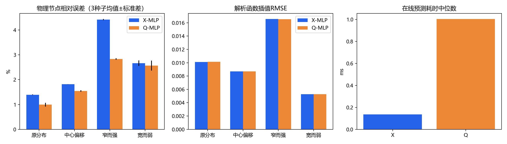

# 变分网格学习：扩展实验与学习归档

**状态：追加训练暂停；作为课程与学习实践保存。**
[最新归档](学习实践归档_2026-10-24/README.md)收录最近邻复核、9409节点测试及项目定位；[原理与文献入口](../项目导读/06_从实验到原理的学习入口.md)用于后续学习。以下保留历史结果。

## 跨场物理网络与新的传统对照

[物理场扩展_2026-10-23](物理场扩展_2026-10-23/README.md)集中保存后续三轮工作及完整运行数据：高斯物理模型＋L-BFGS、四类场物理教师与Poisson验证、192场跨场网络训练。96个测试组合原始网格全部合法，波前和单峰平均改善PDE误差；双峰与圆环以及精修加速仍是后续问题。[下一窗口研究交接](物理场扩展_2026-10-23/下一窗口研究交接.md)作为历史资料保留。下文保留此前两轮物理研究的设置与结果。

**让教师标签与最终物理优化目标一致后，预测网格的插值误差下降，作为迭代初值的收益也更明显。**
本目录在已完成的课程设计之外保存两次独立探索。旧论文、网页、五轮实验和原2015年论文复现的位置保持原样。

## 阅读入口

- [探索脉络与比较口径](探索脉络.md)：为什么先比较X/Q，再重新生成物理教师。
- [探索一：直接物理预测与精修](工程与实验/runs/physical_X_01/中文结果分析.md)：400例、3种子，预测精度与在线成本的取舍。
- [探索二：物理教师监督训练](工程与实验/runs/physical_teacher_01/中文研究报告.md)：2000组物理教师、3种子新模型与20例同目标精修。
- [完整数据、权重与可运行源码ZIP](../../../downloads/变分网格_物理教师监督训练与前轮对照_完整复现包.zip)，约46.6 MiB；[复现说明](复现说明.md)。
- [返回原课程设计](../README.md)。

## 探索一：直接输出X，是否就会更好？

固定1200训练、400验证、400测试，网络4→128→128→242，三个相同随机种子。
标签仍来自冻结Q教师及其重建X。节点误差按对应教师的总内部位移归一化。

|方法|对Q教师重建X的节点误差|插值RMSE|在线预测平均耗时|
|---|---:|---:|---:|
|直接X模型|2.574%|0.010170|0.153 ms|
|Q模型重建X|1.984%|0.010160|1.054 ms|

直接X省去重建，在线更快，但在相同训练预算下没有更准。
在20例同物理目标精修中，规则/X预测/Q重建/最近邻初值平均耗时分别为0.547/0.442/0.447/0.460秒。
四种方法全部收敛，终点能量接近；X与Q的精修成本相近，最近邻也有收益。

## 探索二：改用物理优化结果作为教师

沿用相同参数清单和划分，从规则物理网格出发，实际求解非线性物理能量。
1200训练、400验证、400测试全部达到梯度容差；新X模型沿用相同结构、预算和三个种子。

|模型|对新物理教师的节点误差|插值RMSE|原始几何合法率|
|---|---:|---:|---:|
|物理教师X模型|2.150%|**0.009555**|100%|
|原Q教师X模型|16.777%|0.010170|100%|
|Q模型重建X|16.963%|0.010160|100%|

本表换成了新物理教师参照，旧模型的16%误差不表示其原有拟合精度退化，也不能与上一表的约2%直接比较。
新模型插值RMSE相对旧Q模型重建X降低约5.96%；这是实际函数指标的改善。

|同物理能量精修初值|平均迭代数|本轮平均耗时|相对规则初值配对加速|
|---|---:|---:|---:|
|规则网格|206.80|0.992 s|1.00×|
|物理教师X模型|**112.05**|**0.499 s**|**1.96×**|
|原Q教师X模型|168.45|0.797 s|1.27×|
|Q模型重建X|166.60|0.764 s|1.30×|

20例、每方法重复2次，全部收敛。加速比只对相同算例、同一次重复且终点能量相对差≤10⁻⁶的记录计算，
取配对比值的几何均值，因此不等于表中平均耗时之比。两轮绝对耗时来自各自运行，横跨两轮不作加速比较。

## 看实际网格

四行分别对应原分布、中心偏移、窄而强、宽而弱；列为物理教师、新物理X模型、原Q教师X模型、Q模型重建X。

## 文件组织

    扩展研究/
    ├── README.md、探索脉络.md、复现说明.md
    └── 工程与实验/
        ├── src/                          共享数值、网络和评价源码
        └── runs/
            ├── physical_X_01/            探索一报告、源码、结果表、图像和训练记录
            └── physical_teacher_01/      探索二报告、源码、结果表、图像和训练记录

网页阅读区保留源码、报告、CSV和图像。完整教师节点、逐步精修状态和模型权重集中在下载ZIP中；
解压后恢复原工程目录，可直接运行。原课程工程和原有下载包保持原样。

## 当前结论与限制

结果支持“与物理目标一致的教师监督＋传统精修”作为下一步方向。
收益是当前物理优化器从更好的初值开始、用更少迭代达到相近终点，不是超过传统迭代的最终求解精度。
物理能量与冻结Q二次能量不同；此前稀疏Q直接解的毫秒耗时不能与本轮秒级物理优化拼成同精度加速。
当前为固定12×12划分、有限高斯参数范围；尚未验证更大网格、复杂场或真实PDE误差，
也未比较全部更强的传统非线性求解器。在线成本不包含离线教师生成与训练成本。
教师是达到梯度容差的驻点，未证明为全局最优。
