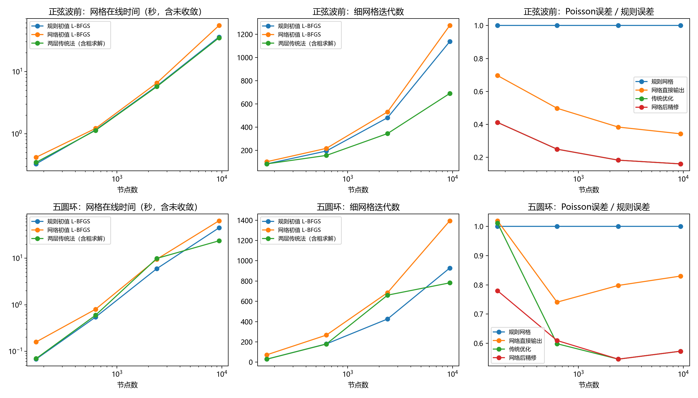
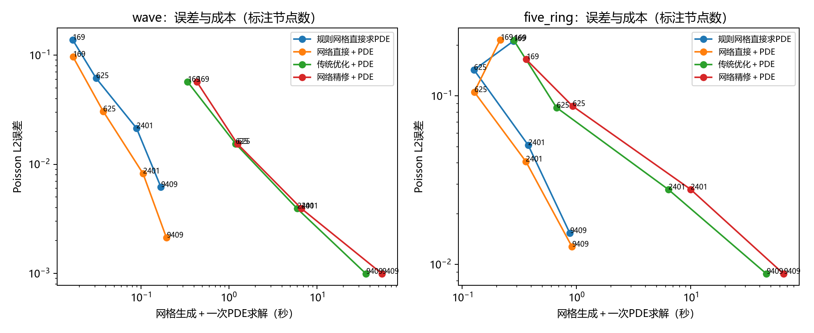

# 数值实验与学习实践归档

**项目现定位为机器学习课程设计与学习探究实践；追加训练已暂停。**
已有局部收益作为对应条件下的实验结果保留，现有证据没有建立可靠、广泛适用的实际优化优势。
后续工作以阅读他人成果、理解已有公式与程序、用必要复现帮助学习为主。

## 最近归档的两项工作

|工作|实际完成|主要认识|
|---|---|---|
|跨场方向复核与最近邻对照|核对新训练、强传统基线和PDE评价；48个n12场作最近邻检索|简单最近邻对教师的节点误差25.55%，当前网络40.50%，现模型尚未学好已有标签|
|公开解析算例与规模测试|MMPDElab波前/五圆环解析场，169/625/2401/9409节点；48次优化及PDE评价|扩大节点数没有自动带来网络初始化收益；两层传统法更有竞争力|

## 大规模测试：负结果完整保留

固定现有跨场模型，在相同物理能量、L-BFGS和梯度容差下比较，9409节点结果为：

|解析场|规则初值平均时间|网络初值平均时间|两层传统法（含粗解）|
|---|---:|---:|---:|
|正弦波前|35.90 s|54.72 s|34.74 s|
|五圆环|44.94 s|63.80 s|23.65 s|

两种最大规模问题均收敛且终点能量可比，网络初值反而增加迭代。
直接使用网络网格有较低成本，但与充分优化后的误差不同，不能称为同精度加速。
每类仅一个固定解析实例、各两次计时，属于学习性质的规模压力测试。
使用了公开解析函数，但度量、边界与求解器配置不同，不是官方完整基准复现。

## 如何理解历史上较好的数字

- 约1.96倍：高斯物理教师模型相对谱梯度规则初值，在固定20例上的配对收益。
- 约1.28倍：换成L-BFGS强基线后的高斯初值收益。
- 约1.02倍：首轮跨场网络相对同L-BFGS基线，未建立明显加速。
- 9409节点：本轮两种问题网络精修更慢，传统两层初值在五圆环上更有效。

这些结果对应不同设置，不能挑选最大数字作为项目总体性能。
它们保留为理解输入表示、教师目标、优化初值、离散误差和实验设计的材料。

## 完整记录与复现

- [方向复核](../物理场扩展_2026-10-23/工程/reviews/20261024_direction_audit/方向复核.md)、
  [最近邻逐例数据](../物理场扩展_2026-10-23/工程/reviews/20261024_direction_audit/nearest_per_case.csv)、
  [对照代码](../物理场扩展_2026-10-23/工程/reviews/20261024_direction_audit/nearest_control.py)。
- [规模测试报告](../物理场扩展_2026-10-23/工程/runs/benchmark_scale_05/中文测试报告.md)、
  [原始计时](../物理场扩展_2026-10-23/工程/runs/benchmark_scale_05/timings.csv)、
  [PDE数据](../物理场扩展_2026-10-23/工程/runs/benchmark_scale_05/pde.csv)、
  [源码、节点和历史](../物理场扩展_2026-10-23/工程/runs/benchmark_scale_05/)。
- [规模测试完整复现ZIP](../../../../downloads/公开解析算例与9409节点规模测试_复现包.zip)：含冻结模型、依赖源码和结果，约5.1 MiB。

最近邻与规模实验沿用既有共享工程，路径未重新组织；下载完整仓库后，在
扩展研究/物理场扩展_2026-10-23/工程内按对应报告运行即可。
单独解压规模测试ZIP，也可加载模型、预测并重新生成图表。无需重训即可阅读现有结果。
sources内MMPDElab官方MATLAB文件保留其AGPL-3.0许可，来源与配置差异见测试报告。

## 从实践回到学习

[原理与文献入口](../../项目导读/06_从实验到原理的学习入口.md)按已有实验中的问题连接公式、代码和参考论文。
后续以当前提出的学习问题为范围；扩数据、容量消融和多规模训练保留为历史设想。

[项目首页](../../README.md) · [完整探索过程](../../探索总览/README.md) · [项目状态](../../项目状态.json)
