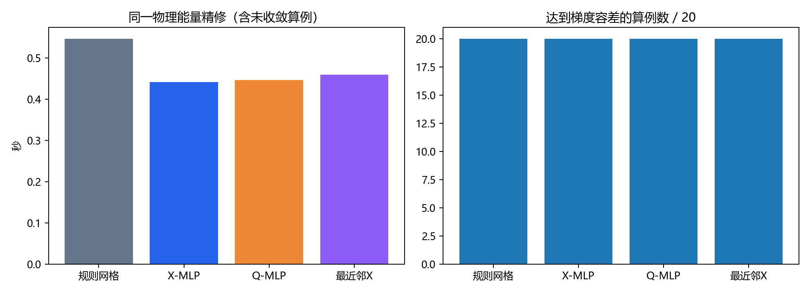

# 直接物理网格预测与精修补充实验

直接学习X的平均物理节点误差为 **2.574% ± 0.029个百分点**，
高于相同训练预算下Q-MLP重建X的 **1.984% ± 0.069个百分点**。
逐测试样本、逐种子配对时，X模型的节点误差更小比例为14.1%，插值误差更小比例为45.5%。

直接X预测在线耗时约0.153毫秒，Q预测并重建约1.054毫秒。
在20例相同物理能量精修中，规则初值平均0.547秒，
X初值0.442秒，Q初值0.447秒，
最近邻X初值0.460秒，四种方法全部收敛到能量相近的终点。
这些结果支持将预测网格用作非线性物理优化初值，但没有显示直接学习X比学习Q具有精度或精修成本上的明显优势。
最近邻也能降低精修成本，神经网络在本测试中的额外收益有限。

## 数据和公平比较

复用1200组真实高斯教师训练数据、400组验证数据、400组独立测试数据。原分布、中心偏移、窄而强、宽而弱各占测试集100组。
这些组均包含在扩展训练范围内。网格12×12划分、169节点、121内部节点、288三角形。
两种网络均为4→128→128→242，Tanh隐藏层，Adam学习率0.001、权重衰减10⁻⁶、批量128、最多2000轮、
验证早停耐心200、最小改善10⁻⁷，种子20261023/24/25，CPU单线程；标准化仅使用训练数据。
Q模型直接复用已经训练好的对应权重，X模型从头训练。误差分母为教师内部节点相对于规则网格的总位移范数。
X标签是冻结Q教师重建出的物理网格，不是下文物理能量的极小点。

## 直接预测的物理节点结果

|测试组|X-MLP直接预测|Q-MLP重建X|
|---|---:|---:|
|原分布|1.394%|0.993%|
|中心偏移|1.815%|1.545%|
|窄而强|4.423%|2.832%|
|宽而弱|2.665%|2.566%|
|全部|2.574%|1.984%|

每类3个模型各1200次、共2400次预测的原始几何/重建成功率：X为100.00%，Q管线为100.00%。
原始预测和最终使用的节点均保存在prediction_states；非法X预测按位移逐次减半直到几何合法，边界始终固定。
合法性条件为节点有限、位于单位正方形、边界不动、所有三角形有向面积大于10⁻¹⁰。

### 解析函数插值误差

目标函数为u(x)=exp(−‖x−c‖²/σ²)，在相同80×80物理采样点上计算分片线性插值RMSE。
节点误差与此函数误差是不同指标。

|测试组|X-MLP|Q-MLP|Q教师X|规则网格|
|---|---:|---:|---:|---:|
|原分布|0.010117|0.010126|0.010108|0.009739|
|中心偏移|0.008712|0.008707|0.008721|0.009721|
|窄而强|0.016571|0.016530|0.016905|0.019337|
|宽而弱|0.005279|0.005278|0.005278|0.005893|
|全部|0.010170|0.010160|0.010253|0.011172|

## 以X为变量的物理变分优化

沿用第四轮已经实现的物理能量与Armijo谱梯度法，原项目保留不变。
参考三角形边矩阵记为A，物理三角形为B(X)，J=A B(X)⁻¹，m(X)=1+α exp(−‖中心(X)−c‖²/σ²)。
取θ=1/3、p=2，使用三角形中心求积：

$$E_{phys}(X)=\sum_K |K(X)|m_K(X)
\left[\frac13\left(\frac{\|J_K(X)\|_F^2}{m_K(X)}\right)^2
+\frac43\left(\frac{\det J_K(X)}{m_K(X)}\right)^2\right].$$

面积、矩阵逆及度量场对X的依赖全部纳入64位自动微分。方向差分核对见physical_gradient_check.json。
该能量与冻结Q的二次Winslow能量不同，二者能量数值及求解耗时不构成同目标加速比。
本节只比较相同物理能量、相同算法、相同固定边界、相同梯度容差10⁻⁵、
相同3000次迭代及30000次能量求值上限下的四类初值。
每组预先选测试清单前5例，共20例；模型固定使用种子20261023。各方法交替顺序重复2次。
最近邻在训练参数标准化距离下检索缓存的教师X。耗时包含在线初值构造与精修，不含模型/数据加载及结果后处理。

|物理优化初值|收敛算例|每例两次耗时中位数的均值(s)|平均迭代数|平均最终梯度范数|插值RMSE|
|---|---:|---:|---:|---:|---:|
|规则网格|20/20|0.5470|206.8|8.64e-06|0.009659|
|X-MLP|20/20|0.4421|168.4|8.40e-06|0.009659|
|Q-MLP|20/20|0.4465|166.6|8.93e-06|0.009659|
|最近邻X|20/20|0.4597|173.2|8.62e-06|0.009659|

全部20例均保留在上表，未收敛的结果也计入耗时及误差。
仅当同一例两种初值都达到梯度容差、终点物理能量相对差不超过10⁻⁶时，才计入相同终点的速度比较：

|初值|与规则初值可比算例数|配对加速比几何均值|
|---|---:|---:|
|规则网格|20|1.000×|
|X-MLP|20|1.287×|
|Q-MLP|20|1.263×|
|最近邻X|20|1.215×|

加速比按同一算例、同一次重复的规则初值耗时除以对应方法耗时计算。它描述当前物理优化器的初值效果。
精修后的几何及每步能量/梯度/回溯记录保存在refinement_states；失败停止原因保留在physical_per_case.csv。

## 结果解释与研究判断

直接输出X消除了Q→X的三角形插值，因此在线成本显著降低；但省去数值重建不等于神经网络误差必然更小。
本实验中X标签包含重建映射的非线性，固定网络和训练预算下，X映射的实际拟合结果更差，窄而强一组尤其明显。
这是一项实测判断，不能由此推导所有网络都应学习Q，或给出X表示优越性的普遍定理。

物理精修把两类预测带到能量相近的终点，最终插值误差几乎一致。
X-MLP与Q-MLP平均精修成本接近，微小时间差不能解释为坐标表示优势。
精修能否受益应看初始物理网格与该物理目标的匹配程度；Q教师的高精度拟合不保证就是物理能量的最佳初值。
如果继续发展物理网格路线，值得验证的是以同一物理能量生成教师标签后再学习X，
并与该目标下更强的传统优化器比较，而不仅把现有标签的输出坐标替换成X。

## 适用范围和限制

这些实验检验固定分辨率、扩展高斯范围内的预测及小样本物理精修，不证明复杂场或任意分辨率泛化。
物理能量非线性，不保证不同初值到同一极小点。当前比较复用同一传统物理优化器，不能推出优于所有传统算法。
精修模型只学习Q教师的重建X；若要学习物理能量的最优解，需要另建对应的物理教师数据。
插值实验是解析函数的有限元插值误差，没有运行PDE求解，也不表示实际PDE误差。

## 复现与数据

在独立研究项目根目录执行：

    python runs/physical_X_01/run.py
    python runs/physical_X_01/analyze.py

依赖numpy、scipy、matplotlib、torch。已有X权重会被复用；重新训练时使用新的输出目录保留本次结果。
run.py引用本项目src、gaussian_1200真实教师库和既有3份Q权重，均保留在父项目。
prediction_per_case.csv有2400行，physical_per_case.csv有160行，summary_prediction.csv和summary_physical.csv给出汇总。
