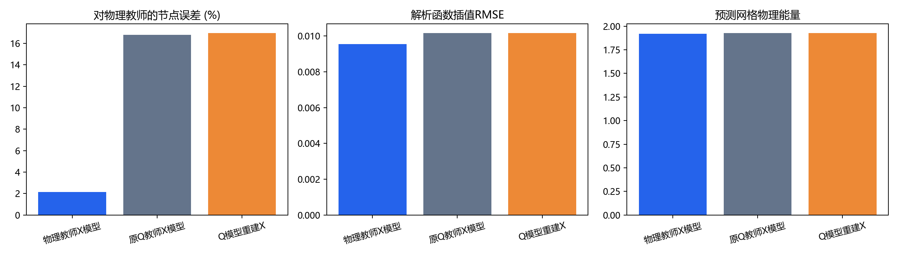
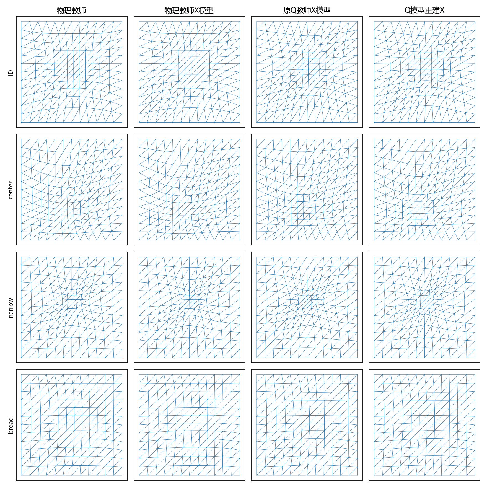

# 物理能量教师监督的网格学习

本实验从物理能量的数值极小点生成X标签，训练3个小型MLP，并在相同测试参数上与原有模型比较。

物理教师X模型的插值RMSE为0.009555，
相对旧Q模型重建X降低5.96%。
在20例同目标精修中，其平均迭代从规则初值的206.80次降到112.05次，
对规则初值的配对加速比为1.96倍。
全部四类初值均在20例、各2次运行中收敛，且终点能量满足配对条件。
这支持使用与最终物理优化目标一致的教师标签，作为后续研究路线。

## 直接预测结果

|模型|对物理教师的节点相对误差及种子标准差(百分点)|原始合法率|函数插值RMSE|平均物理能量|
|---|---:|---:|---:|---:|
|物理教师X模型|2.150% ± 0.016|100.0%|0.009555|1.920169|
|原Q教师X模型|16.777% ± 0.083|100.0%|0.010170|1.927347|
|Q模型重建X|16.963% ± 0.038|100.0%|0.010160|1.927785|

本表全部以新物理教师作为节点参照。原Q教师X模型和Q模型学习的是不同目标，
因此这里的节点误差不能与此前对Q教师的1.98%或2.57%直接比较。
物理教师自身的函数插值RMSE为0.009667，规则网格为0.011172。

|测试组|物理教师X模型|原Q教师X模型|Q模型重建X|
|---|---:|---:|---:|
|ID|1.042%|17.027%|17.155%|
|center|1.464%|15.294%|15.317%|
|narrow|3.595%|15.519%|15.827%|
|broad|2.500%|19.268%|19.553%|

## 相同物理目标的在线精修

预先固定每组前5例，共20例；使用种子20261023，交替顺序各重复2次，CPU单线程。
耗时包括预测、合法性处理及优化。模型和数据加载、指标后处理在计时外。
四类初值使用同一物理能量、Armijo谱梯度算法、梯度容差10⁻⁵、3000迭代及30000求值上限。
只有双方收敛且终点能量相对差≤10⁻⁶才计入配对加速比。

|初值|收敛运行数|平均耗时(s)|平均迭代|同终点配对数|对规则初值配对加速比|
|---|---:|---:|---:|---:|---:|
|规则物理网格|40/40|0.9921|206.8|40|1.000×|
|物理教师X模型|40/40|0.4993|112.0|40|1.961×|
|原Q教师X模型|40/40|0.7970|168.4|40|1.273×|
|Q模型重建X|40/40|0.7639|166.6|40|1.302×|

全部运行均保留在refinement.csv，包括未收敛结果；配对加速比为逐例逐次比值的几何均值。
此前冻结Q目标的稀疏直接解不属于本节物理目标的求解器，不与这些时间混算。

## 教师、模型与数据

复用原扩展高斯参数清单与独立划分，申请1200训练、400验证、400测试。
实际合格数量为{'train': 1200, 'validation': 400, 'test': 400}；未达到教师容差的样本数为0。
教师从规则物理X出发，采用固定边界；达到10⁻⁵梯度容差才入库。
首轮未收敛者从当前节点继续求解，最多10000迭代、100000求值；失败实例保留JSON状态。
物理能量实现复用上一轮physical_energy.py，面积、逆矩阵、度量场采样位置全部对X求导。
参考边矩阵A、物理边矩阵B，J=AB⁻¹，m=1+αexp(−‖三角形中心−c‖²/σ²)，能量为：

$$E(X)=\sum_K |K(X)|m_K(X)
\left[\frac13(\|J_K(X)\|_F^2/m_K(X))^2+
\frac43(\det J_K(X)/m_K(X))^2\right].$$

MLP为4→128→128→242，Tanh隐藏层，目标为物理教师内部位移。
训练种子20261023/24/25，Adam学习率0.001、权重衰减10⁻⁶、批量128、
最多2000轮、验证耐心200、最小改善10⁻⁷。输入标准化及标签尺度仅由训练数据确定。
教师生成并行；训练和在线计时阶段没有教师任务同时运行。
解析函数u=exp(−‖x−c‖²/σ²)，在80×80固定物理点上评价线性插值。
节点误差以物理教师相对规则网格的总内部位移归一化。

## 限制

非线性物理教师是达到梯度容差的驻点，不是经过证明的全局最优解。
本实验只覆盖固定12×12划分和扩展高斯范围，不建立跨分辨率或复杂场泛化结论。
旧模型的目标不同；三种表示的结果体现目标及表示的共同影响，不能据此单独证明物理坐标的数学优越性。
精修对照使用现有谱梯度优化器，不代表优于所有传统非线性求解器。
函数插值误差不等于真实PDE求解误差。离线教师生成和训练有额外成本，在线收益不包含这部分成本。

## 复现

在独立项目根目录执行：

    python runs/physical_teacher_01/study.py
    python runs/physical_teacher_01/report.py

已有教师和模型会复用。依赖numpy、scipy、matplotlib、torch。
data/teachers保存物理教师；models保存权重、逐轮损失；test_states保存教师与三个模型预测节点。
teacher_status.csv、prediction.csv、refinement.csv为原始结果；summary_*.csv为汇总。
