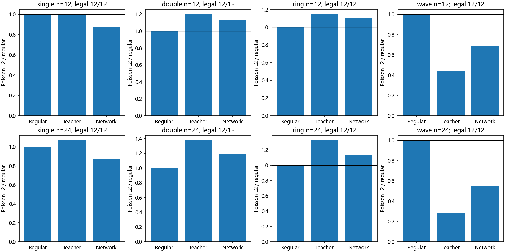

# 直接物理网格：跨场训练与PDE验证

直接物理网格网络已扩展到单峰、双峰、圆环和波前。192个训练场、48个验证场和48个测试场独立划分；在12×12网格训练，在12×12和24×24网格上评测96个组合，原始预测全部合法。

网络直接预测的Poisson误差相对规则网格平均比值如下，小于1表示改善：

|场|12×12|24×24|
|---|---:|---:|
|单峰|0.873|0.869|
|双峰|1.130|1.191|
|圆环|1.107|1.137|
|波前|0.693|0.549|

波前平均误差降低约31%—45%，双峰和圆环仍比规则网格差。相对物理教师的位移误差约34%—48%，教师拟合尚粗。固定16组合的32次传统精修均收敛，同终点配对耗时比为1.024倍，本轮尚未建立明显的加速收益。



## 三轮实验如何衔接

|实验|问题与结果|入口|
|---|---|---|
|物理混合求解02|同一高斯物理教师模型接入L-BFGS；20例重复两次，相对规则初值L-BFGS配对加速1.277倍；独立弱形式Winslow教师与直接离散Q标签一致|[报告](工程/runs/physical_hybrid_02/README.md)|
|跨场物理教师03|直接物理优化扩到四类场；16例全部合法收敛，7例改善Poisson误差、9例上升|[报告](工程/runs/physical_fields_03/README.md)|
|跨场网络训练04|用采样度量场代替四参数高斯输入，实际训练新模型并评测96组合|[报告](工程/runs/physical_field_training_04/README.md)|

02复用此前单高斯物理网络，03生成控制算例，04是本目录新增的网络训练。三者不是三轮新网络训练。较早的[物理教师监督研究](../工程与实验/runs/physical_teacher_01/中文研究报告.md)、[原课程项目](../../README.md)及其下载包继续保留。

## 代码、数据与权重

本目录工程是可独立运行的研究快照，保留这三轮所需的共享源码和既有模型依赖：

```text
工程/
├── requirements.txt
├── src/                               共享网格、Q教师及模型定义
└── runs/
    ├── physical_X_01/                 物理能量、问题定义及既有运行依赖
    ├── physical_teacher_01/models/    实验02所用的既有单高斯物理模型
    ├── physical_hybrid_02/            L-BFGS与弱形式对照、逐例网格与结果
    ├── physical_fields_03/            四类解析场、P1 Poisson、16例教师
    └── physical_field_training_04/    新跨场模型、336组教师、96组测试记录
```

跨场模型权重为[model.pt](工程/runs/physical_field_training_04/model.pt)。[训练日志](工程/runs/physical_field_training_04/training_log.csv)、[全部测试结果](工程/runs/physical_field_training_04/test_results.csv)、[精修对照](工程/runs/physical_field_training_04/refinements.csv)与[数据清单](工程/runs/physical_field_training_04/manifest.json)均直接纳入本目录。

## 运行

进入本目录的工程文件夹，使用已有Python环境安装依赖：

```powershell
python -m pip install -r requirements.txt
python runs/physical_fields_03/verify.py
```

只从已保存结果重建跨场报告：

```powershell
python runs/physical_field_training_04/report.py
```

训练脚本具有prepare、train、evaluate、all四个阶段。完整流程命令如下，会使用本目录的输出路径；新一轮研究另设运行目录，以便对照。

```powershell
python runs/physical_field_training_04/study.py all
```

## 下一窗口入口

[研究续接说明](下一窗口研究交接.md)记录当前状态、实际工作目录、验证结果和后续实验问题。

## 限制

本轮跨场训练只有一个种子和192个训练场，四类场均在训练中出现，测试为新参数及新尺度。它不证明未见场类别、复杂区域或任意网格泛化。教师优化网格能量，并不保证改善PDE误差；网络比教师的PDE误差小也不能直接视为更好的教师拟合。精修耗时每组合只测一次，属于探索性数据。尚未执行公开大型基准。
