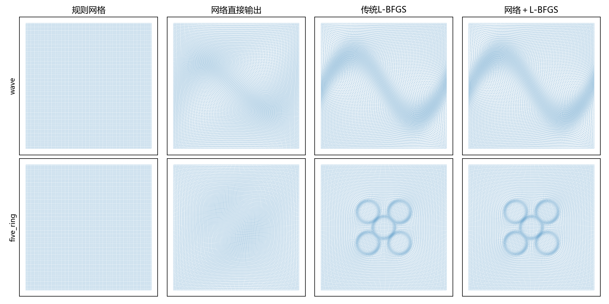

# 公开解析算例与规模测试

现有模型在两种9409节点问题上，未建立“网络初值＋精修”的同目标加速：
波前规则/网络初值平均35.90/54.72秒，
五圆环为44.94/63.80秒。
节点增多本身没有使预测初值更有效。直接使用网络网格则有成本与误差的取舍，详见后文。

本轮冻结既有跨场模型，不重新训练，实际完成2个解析场×4档规模×3类优化初值×2次重复。
最大9409节点、18432三角形，节点数为原169节点的55.7倍。
原始网络预测合法8/8例。

## 同目标耗时与迭代

|场|节点|初值|收敛|完整网格时间(s)|细网格迭代|可比配对|配对加速|
|---|---:|---|---:|---:|---:|---:|---:|
|wave|169|规则|2/2|0.330|82.0|2/2|1.000|
|wave|169|网络|2/2|0.422|101.0|2/2|0.789|
|wave|169|两层|2/2|0.349|82.0|2/2|0.955|
|wave|625|规则|2/2|1.160|193.0|2/2|1.000|
|wave|625|网络|2/2|1.226|216.0|2/2|0.930|
|wave|625|两层|2/2|1.141|155.0|2/2|0.998|
|wave|2401|规则|2/2|5.864|481.0|2/2|1.000|
|wave|2401|网络|2/2|6.563|531.0|2/2|0.894|
|wave|2401|两层|2/2|5.725|344.0|2/2|1.029|
|wave|9409|规则|2/2|35.904|1138.0|2/2|1.000|
|wave|9409|网络|2/2|54.724|1277.0|2/2|0.642|
|wave|9409|两层|2/2|34.735|690.0|2/2|1.010|
|five_ring|169|规则|2/2|0.068|30.0|2/2|1.000|
|five_ring|169|网络|2/2|0.159|73.0|0/2|—|
|five_ring|169|两层|2/2|0.070|30.0|2/2|0.973|
|five_ring|625|规则|2/2|0.544|180.0|2/2|1.000|
|five_ring|625|网络|2/2|0.802|267.0|0/2|—|
|five_ring|625|两层|2/2|0.597|179.0|2/2|0.911|
|five_ring|2401|规则|2/2|5.976|426.0|2/2|1.000|
|five_ring|2401|网络|2/2|9.554|686.0|2/2|0.625|
|five_ring|2401|两层|2/2|9.910|661.0|2/2|0.603|
|five_ring|9409|规则|2/2|44.939|928.0|2/2|1.000|
|five_ring|9409|网络|2/2|63.803|1394.0|2/2|0.705|
|five_ring|9409|两层|2/2|23.652|782.0|2/2|1.899|

规则与网络使用同一物理能量、L-BFGS、梯度容差10⁻⁵、3000迭代和30000求值上限。
同一例两种初值均收敛且终点能量相对差≤10⁻⁶才计算加速。
所有停止原因、耗时及终点能量均保留。时间包含初值构造、几何处理与优化；不含模型加载和PDE后处理。
两层法先从规则网格求解前一档粗问题，再将位移双线性插值到细网格精修；
时间已加入那次粗网格规则求解的两次耗时中位数，不假设免费拥有粗解。
不同n使用相同离散梯度范数阈值，不能将此视为统一连续误差容差。

## PDE精度

以同一解析函数构造−Δu=f和四边精确Dirichlet条件。
P1有限元沿用既有实现。波前与较细五圆环使用8×8 Duffy求积；
五圆环n12采用32×32、n24采用12×12，以解析窄环层。
最粗五圆环的24×24与32×32求积比较，规则/两种优化网格的L2误差相对变化最大约2.56×10⁻⁶。
右端自动微分按32768点分批，控制大网格内存。在线计时与求积验证分开进行。
下表为同节点数Poisson L2误差与规则网格之比，小于1为改善。

|场|节点|网络直接|传统优化|网络精修|
|---|---:|---:|---:|---:|
|wave|169|0.696|0.412|0.412|
|wave|625|0.498|0.250|0.250|
|wave|2401|0.384|0.183|0.183|
|wave|9409|0.343|0.161|0.161|
|five_ring|169|1.020|1.012|0.780|
|five_ring|625|0.741|0.599|0.610|
|five_ring|2401|0.798|0.546|0.546|
|five_ring|9409|0.830|0.573|0.573|

pde.csv保留PDE线性求解残差、完整组装求解时间、误差及面积。
summary.csv的mesh_and_poisson_seconds为网格生成与该状态一次PDE求解的时间和，
误差评估不计时。每状态PDE只计一次，不能用它声称稳健的端到端加速。

图中直接网络与精修输出达到的误差不同，不能把纵坐标不同的两点直接相除作为同精度加速。
更低网格成本但更高任务误差属于近似取舍；是否可用需要应用先给出误差阈值。

## 与公开算例的关系

解析函数来自MMPDElab官方examples/ex2d_1.m的case 3及case 5：

- 波前：u=tanh[−30(y−1/2−sin(2πx)/4)]。
- 五圆环：令ξ=4x−2、η=4y−2，中心为(0,0)、(±1/2,±1/2)，
  u为五项tanh[30((ξ−a)²+(η−b)²−1/8)]之和。

官方来源：https://github.com/weizhanghuang/MMPDElab/blob/master/examples/ex2d_1.m

本地与官方的重要差别：官方使用MovMesh_metric构造并平滑度量，默认只固定角点，
采用MovMesh/MovMesh_XM等时间积分；本轮使用固定全部边界、当前自定义标量m、
现有Huang物理能量及L-BFGS。波前m沿用训练定义，五圆环m=1+8Σexp[−(30d)²]。
此外增加了制造解Poisson评价。因此这是公开解析场的本地移植与规模压力测试，不是MMPDElab官方算法复现。

波前的函数族参加过训练；五圆环没有参加训练。模型输入仍是32×32采样，
细网格节点增加不提高输入分辨率，也不表示网络跨尺度误差自动下降。
每类只有一个固定解析实例，重复计时2次，仅作探索性规模测试。

## 可进一步接入的公开基准

|项目|实际提供的内容|当前接入状态|
|---|---|---|
|MMPDElab|解析场、Poisson与移动网格的MATLAB源代码|已读取官方源文件并移植上述解析函数；当前环境未发现matlab/octave命令|
|UM2N|Poisson/Helmholtz/Burgers数据生成、Swirl评测与数据/权重入口|已核对官方README和评测代码；当前Python缺少Firedrake、Movement、torch_geometric，未跑官方评测|
|UGAWG adapt-benchmarks|各向异性自适应基准和度量评价约定|已核对公开入口；含3D和改变拓扑任务，当前二维固定拓扑模型不直接适配|

UM2N：https://github.com/mesh-adaptation/UM2N
Swirl评测：https://mesh-adaptation.github.io/docs/_modules/UM2N/test/bench_swirl.html
UGAWG：https://github.com/UGAWG/adapt-benchmarks

这些不是一个免适配的统一排行榜。当前网络不能原样处理任意多边形、三维体网格或完整各向异性张量。
官方对照应共同报告同自由度预算下的几何合法性、PDE误差和完整在线成本；
UM2N的Monge–Ampère目标与当前Huang目标不同，不能比较终点能量作为精度等价依据。

## 复现

在现有独立研究工程根目录运行：

    python runs/benchmark_scale_05/benchmark.py
    python runs/benchmark_scale_05/report.py

复用runs/physical_field_training_04/model.pt及其输入处理，runs/physical_hybrid_02的L-BFGS、
runs/physical_fields_03的PDE模块。旧源码和模型保持不变。
config.json固定所有解析参数、规模、预算；timings.csv、paired.csv、pde.csv和states保存真实记录。
