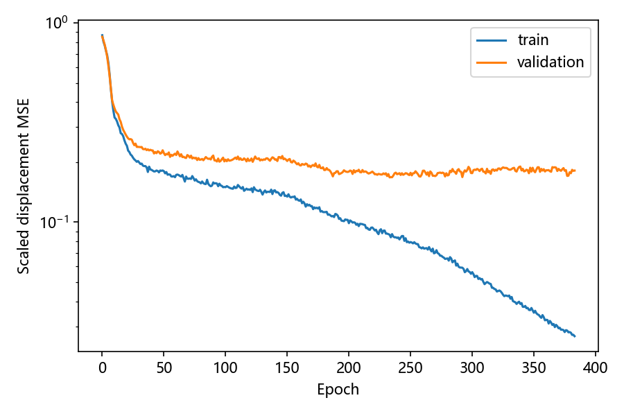

# 跨场物理网格网络：首轮训练

网络已完成四类场监督训练，在96个未参与训练的场—网格组合上评测，原始预测合法96/96。
网络直接预测物理位移，教师由直接物理Huang能量优化生成。结果同时报告教师拟合和Poisson误差。

原始96例全部合法且无需退缩。单峰和波前的直接预测平均改善了PDE误差；双峰和圆环仍比规则网格差。相对教师位移误差约34%—48%，拟合尚粗；验证损失在第234轮取得最佳值，而训练损失随后继续下降，说明继续增加训练轮数本身没有改善本轮验证表现。固定子集的32次精修均收敛，配对耗时比1.024倍，尚未建立明显的加速收益。

## 数据与模型

教师生成336/336收敛。训练192场、验证48场、测试48场；每类分别48/12/12场。按场实例划分，测试场的12×12和24×24网格共享同一测试归属。所有四类场均在训练中出现，因此测试新参数和新分辨率，不是未见类别泛化。

输入是32×32 log(m)场及待查询节点的参考坐标；场编码器1024→128→64，坐标解码器66→128→128→2，Tanh隐藏层。输出乘16x(1−x)y(1−y)，使位移在边界连续趋零。训练仅使用12×12网格的内部位移，归一化参数及标签尺度只取训练集。

参数量164802，CPU单线程训练384轮，用时40.4秒；依据验证集选择第234轮，单个训练种子20261026。损失为归一化监督位移MSE，没有把Poisson误差或网格能量加入训练损失。

## 独立测试

相对教师误差按物理教师相对规则网格的位移范数归一化。PDE列为优化/预测网格上Poisson L2误差与同节点数规则网格误差之比，小于1表示改善。PDE评价使用几何合法性处理后的网络输出；原始合法率另外报告。

|场|网格n|原始合法数|相对教师误差|教师PDE误差比|网络PDE误差比|
|---|---:|---:|---:|---:|---:|
|单峰|12|12/12|34.0%|0.991|0.873|
|单峰|24|12/12|34.5%|1.069|0.869|
|双峰|12|12/12|47.7%|1.199|1.130|
|双峰|24|12/12|47.4%|1.376|1.191|
|圆环|12|12/12|40.8%|1.144|1.107|
|圆环|24|12/12|40.8%|1.325|1.137|
|波前|12|12/12|39.5%|0.445|0.693|
|波前|24|12/12|41.5%|0.281|0.549|




网络对教师的拟合误差与PDE误差是不同指标。预测网格若比教师PDE误差更低，也不能据此认定学习方法已超过传统优化：教师最小化的是网格能量，网络可能因欠拟合而保留更多规则网格特征。

## 传统精修

测试清单中每类前两个场、两个分辨率，共16个固定场—网格组合，分别从规则网格和网络初值启动相同L-BFGS。容差10⁻⁵，最多3000迭代和30000能量求值。在线时间包含网络预测及几何处理，PDE后处理与模型加载不计入。

|初值|收敛数|平均迭代|平均在线秒数|平均PDE误差比|
|---|---:|---:|---:|---:|
|规则网格|16/16|151.7|0.9531|0.938|
|网络预测|16/16|142.4|0.9121|0.938|

双方均收敛且终点相对能量差≤10⁻⁶的配对为16/16，其耗时比几何均值为1.024倍。未匹配实例全部保留在refinement_pairs.csv，不纳入这个加速数字；它可能意味着落入不同驻点，不能仅按耗时排名。每个组合运行一次，本轮时间结果为探索性测量。

## 验证与复现

准备阶段检查三种数据划分没有重复场实例；每个教师达到梯度容差且网格合法后保存。预测分别保存raw/safe/teacher节点及原始最小面积、退缩系数。Poisson求解沿用已通过仿射检验、正弦制造解收敛检验和右端导数核对的P1实现，并检查每次线性求解残差。

```powershell
python runs/physical_field_training_04/study.py all
python runs/physical_field_training_04/report.py
```

config.json、manifest.json记录配置和所有场；teachers保存336组物理教师及状态；model.pt保存验证集选出的模型；training_log.csv记录训练过程；test_results.csv保存全部96个测试组合；refinements.csv和refinement_pairs.csv保存传统精修对照。

## 限制

当前仅一个种子、192个训练场、方形区域、标量度量与固定拓扑；坐标查询能输出不同数量节点，不构成跨尺度精度或正面积保证。教师达到数值驻点，不保证全局最优或更小PDE误差；没有执行UM2N或MMPDElab官方完整基准。几何修复会改变网络预测，原始与修复后的表现需分别解释。

下一步首先根据本轮原始合法率和各场误差判断主要限制：教师拟合不足时扩大样本或调整表示；预测非法时改进几何约束；教师PDE误差本身较差时改进度量。不能把三类问题都归因于训练轮数不足。
