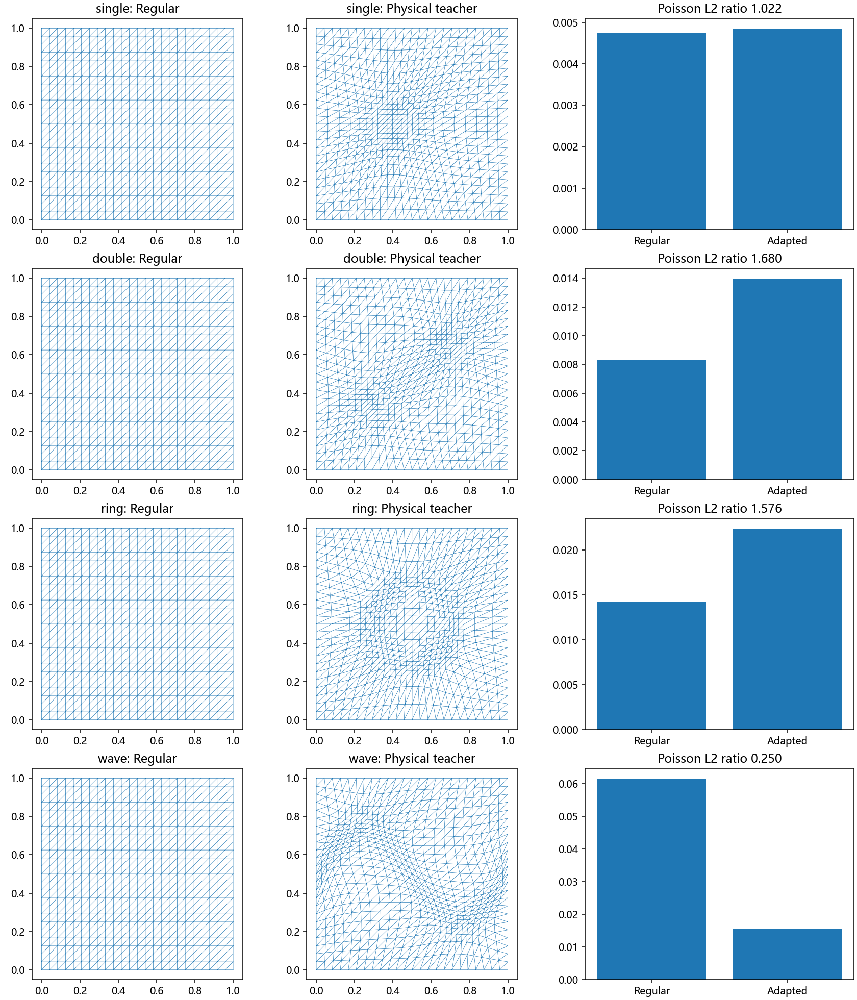

# 物理教师跨场试验与Poisson误差

直接物理网格方法已扩展到单峰、双峰、圆环和波前。16个算例全部达到梯度容差并保持合法网格；波前Poisson误差明显下降，双峰和圆环的部分误差上升。当前自定义标量监控场需要进一步与任务误差对齐，再扩大教师数据并训练场输入模型。

## 实测结果

每类两个参数实例，每个实例使用12×12与24×24两种方格剖分，共16次独立物理优化。对应169/625节点、288/1152三角形。同一算例在规则网格和优化网格上使用相同节点数、拓扑、P1有限元与积分规则求解Poisson方程。

下表为“优化网格PDE L2误差／规则网格PDE L2误差”的两实例算术平均。小于1表示改善。

|场|12×12|24×24|
|---|---:|---:|
|单峰|0.948|1.019|
|双峰|1.166|1.444|
|圆环|1.147|1.383|
|波前|0.406|0.249|

波前在两档网格上平均降低约59.4%和75.1%的误差。总体7/16例改善、9/16例上升；最差双峰24×24实例误差增加约68.0%。优化过程的网格能量均下降，因此不能把更小网格能量等同于更小PDE误差。



## 数学设置

区域为单位正方形，全部边界节点固定。采用既有Huang型物理能量，θ=1/3、p=2、各向同性M=mI。物理坐标X作为优化变量，面积、逆Jacobian以及单元中心处的m都参与自动微分。L-BFGS与可行Armijo搜索采用梯度范数10⁻⁵、最多3000次迭代、30000次能量求值。

单峰与双峰的解析函数u是对应高斯峰之和，m=1+各峰强度加权的高斯值之和。圆环采用u=tanh(30d)、m=1+A exp[−(30d)²]，d=|x−c|²−r²。波前采用u=tanh(−30d)、m=1+A exp[−(d/0.1)²]，d=y−1/2−sin(2πx+phase)/4。全部参数写入config.json。

每个u定义一个制造解Poisson问题：−Δu=f，边界值为u在四边的精确值。右端通过对解析u自动求二阶导数生成；P1刚度矩阵由物理单元梯度组装，载荷与L2误差采用8×8 Duffy变换Gauss求积。它测量实际有限元解误差，并额外保存精确节点值的插值误差，二者不混用。

这些是本项目控制算例，圆环与正弦波前取经典解析场形式；自定义标量监控、固定全部边界等配置不构成MMPDElab或UM2N官方基准复现。

## 已完成的实现与验证

- 原physical_energy.py将高斯度量求值提取为metric_value方法；新FieldEnergy复用相同离散物理能量，覆盖四类场。单高斯的能量和梯度与原公式逐例一致。
- 每例方向有限差分核对完整物理梯度，最大相对偏差2.27×10⁻¹⁰；全部输出网格合法，接受步骤的能量不增。
- P1有限元仿射函数检验最大节点误差3.34×10⁻¹⁵。
- 独立正弦制造解在8/16/32网格的L2收敛阶约1.85、1.96，符合平滑解的P1二阶趋势。
- 高斯右端自动微分与手算Laplacian公式最大差1.43×10⁻¹⁴；本轮Poisson内部方程残差均通过10⁻⁹要求。
- 保持有限元解不变，将误差积分提高到12×12点时，L2误差最大相对变化约0.0126%。此项验证误差评估积分，不代表对载荷积分做了独立阶数扫描。

## 文件与复现

`run.py`负责解析场、物理教师、Poisson求解与绘图，`verify.py`执行PDE组装及右端验证。`results.csv`保留全部16例，`summary.csv`汇总；`completion.json`和`pde_verification.json`记录状态与验证值。

每例NPZ保存原始/优化节点、单元、边界、两种网格上的PDE解以及32×32 log(m)场；对应history.csv保存物理优化历史。它们为后续场输入训练提供教师原型，目前没有划分训练/验证/测试集。

```powershell
python runs/physical_fields_03/run.py
python runs/physical_fields_03/verify.py
```

## 下一步

优先比较现有标量m与从解析Hessian构造的任务导向度量，在同一批场与相同物理优化目标下观察PDE误差和等分布/对齐质量。用这些结果选教师配置，再扩充场实例、划分独立数据集并接入物理场网络。16个教师均已收敛，但它们并非全部优于规则网格，不能直接把全部终点当作“更优PDE网格”标签。

## 限制

这是16例确定性起步试验，不是泛化结论；本轮没有训练新神经网络，没有运行公开大型基准，也没有证明教师为全局极小点。结果针对当前标量度量、边界约束和制造解PDE；不同强度、Hessian张量度量、离散方式与边界处理需要分别评估。
