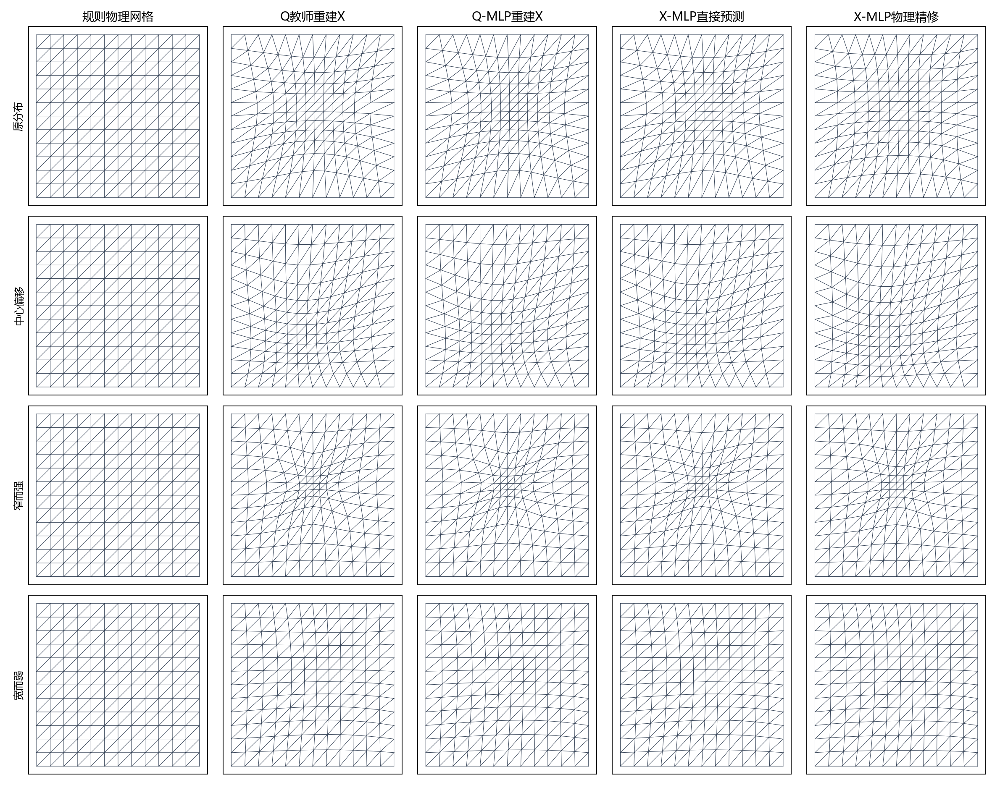
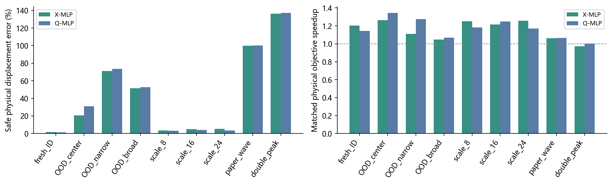
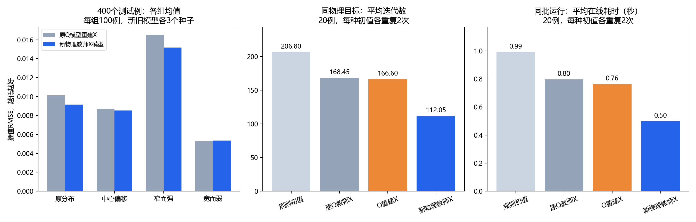

# 我们怎样走到“物理教师＋神经网络＋传统精修”

我们一直想回答一个问题：**移动网格要反复调整节点，能否让神经网络先猜出一个好网格，少做甚至不做迭代？**

目前最有依据的答案是：在已测试的固定网格和高斯参数范围内，网络能够提供有效初值。
当它学习的是最终物理优化器实际得到的网格时，20个测试算例中平均迭代从约207次降到112次，
达到相近最终能量的配对加速约1.96倍。直接预测的函数插值误差也比旧模型约低6%。

这份总览按问题的变化串起历史记录。每一步的设置和数字都来自已保存实验，详表、源码和下载入口放在文末。

## 先认识我们在移动什么

一张网格可以理解为画在正方形上的“有弹性的方格纸”。节点总数不变，
在函数变化快的地方把节点排密，在平缓区域排疏，希望用相同数量的节点更好地描述函数。
这里不改变三角形之间的连接，只移动内部节点，边界固定。

下图来自实际计算。从左到右是规则网格、教师网格、Q模型重建X、直接X预测、X预测后物理精修；
四行依次是原分布、中心偏移、窄而强、宽而弱的高斯场。

图中网格更密不直接等于更好。我们还要检查节点有没有翻转、函数插值误差有多大、最终求解花了多少时间。

|名字|通俗理解|在程序里的用途|
|---|---|---|
|物理节点X|最终画出来、用于计算的节点位置|评价网格质量和插值误差|
|计算节点Q|原教师求解器使用的中间坐标状态|优化后通过重建得到X|
|教师|先用传统方法认真求出一份参考答案|给网络提供真实训练标签|
|MLP|输入高斯中心、强度、宽度，输出内部节点位移的小网络|快速预测网格或优化初值|
|物理精修|从预测的X开始，继续优化物理能量|把近似预测修到共同求解容差|

## 1. 最早的练手：少试几次步长，能否更快？

最初尝试让随机森林预测Armijo初始步长。它确实减少了能量评价次数，但网络特征和预测也要耗时。
高斯度量算例中，标准Armijo平均评价972.7次、耗时0.969秒；随机森林评价298.0次、耗时2.517秒。

**次数减少了，整个程序却更慢。** 于是研究重点从“预测一步迭代的参数”，转向“直接预测移动后的网格”。
[原始实验与其他度量结果](../历史练手/随机森林步长预测/README.md)。

## 2. 直接预测X：网格已经像了，为何接入求解器后误差变大？

先用传统算法生成200组教师，再训练小型MLP预测物理位移X−X₀。
当时希望得到的流程很直接：

~~~mermaid
flowchart LR
    P["高斯参数"] --> N["小型MLP"]
    N --> X["预测物理网格X"]
    X --> U["直接使用"]
    X --> O["作为初值继续优化"]
~~~

但原求解器优化的是Q。把预测X交给它，需要先转成Q，结束后再重建X。
第三轮用30个固定测试例定位到了问题：

|同一批30例的量|平均相对节点误差|
|---|---:|
|X模型刚预测出来|2.195%|
|预测X经过X→Q→X往返|6.280%|
|连精确教师X也做一次同样往返|6.060%|

这说明误差增加主要来自离散插值往返。两次插值的网格与采样位置不同，不能当作精确的互逆变换。
本批实例没有触发几何退缩，因此不是安全处理把预测破坏了。

对应的改进分成两条：**直接学习Q，省去X→Q这一步；或者保留X，让后续优化也直接以X为变量。**
[完整坐标诊断与数据](../工程与历轮实验/experiments/round3/diagnosis.md)。

## 3. 两条路线都能运行，但训练范围之外怎么办？

第四轮比较直接使用X、Q重建X和物理精修，发现预测可以提供可用初值。
第五轮进一步测试60个新问题，暴露了范围限制：

|早期模型的测试情形|X模型物理位移误差|读法|
|---|---:|---|
|新的同分布高斯参数|1.54%|接近训练范围时能较好拟合|
|窄而强的峰|71.21%|超出原范围后误差明显增大|
|宽而弱的峰|51.41%|不能只凭同分布结果判断泛化|

早期双峰和波前测试没有原生输入编码，只用了高斯代理输入；
跨网格规模也用了显式位移插值适配，不能视作网络天然支持任意场、任意分辨率。
[完整泛化报告](../工程与历轮实验/experiments/round5_generalization/文档/泛化测试报告.md)。

这里的误差按教师的总内部位移归一化，不是“节点偏离了整个区域宽度的71%”。
原始、窄峰等组在不同阶段的训练覆盖不同，不能把早期外推失败与后面的扩展范围测试当作同一任务。

## 4. 扩大覆盖以后，直接学X能否胜过学Q？

独立扩展研究增加了训练覆盖和样本量，并进行了种子与容量对照。
其中两条路线的直接比较使用同一1200训练、400验证、400测试，
同一4→128→128→242网络、相同训练预算和三个随机种子。

|同一扩展数据上的方法|对原Q教师重建X的节点误差|直接生成物理网格耗时|
|---|---:|---:|
|直接X模型|2.574%|0.153毫秒|
|Q模型预测并重建X|**1.984%**|1.054毫秒|

结果不是“物理坐标总比计算坐标好”：**直接X执行更快，但相同预算下Q路线更准。**
两者用作物理精修初值时收益也接近，最近邻教师初值同样有帮助。

同时，小规模冻结Q目标本身可以用很强的稀疏直接法求解，学习初值没有显示相同精度的速度优势。
“网络拟合得不错”和“整个求解过程值得使用网络”是两个问题。
[这次X/Q对照的完整结果](../扩展研究/工程与实验/runs/physical_X_01/中文结果分析.md)。

## 5. 关键转折：网络学的答案，是不是最终真正想求的答案？

此前直接X模型的标签，仍来自原Q教师的重建。**输出写成X，并不等于教师优化的目标已经改成物理目标。**

因此最新实验不只是换输出，而是重新生成教师：

~~~mermaid
flowchart TD
    P["相同高斯参数与相同数据划分"] --> OLD["原路线：优化Q，再重建X作为标签"]
    P --> NEW["新路线：直接优化物理能量，得到X标签"]
    OLD --> OM["旧X模型 / Q模型"]
    NEW --> NM["新物理教师X模型"]
    NM --> FAST["直接给出近似物理网格"]
    NM --> REF["作为初值，用同一物理能量精修"]
    REF --> END["以更少迭代达到相近终点"]
~~~

实际生成了1200训练、400验证、400测试的物理教师，全部达到梯度容差。
新模型保持相同网络结构、训练预算和三个种子。

**先看同一个函数的插值误差：**

|400例测试，三个种子均值|插值RMSE，越低越好|
|---|---:|
|原Q教师X模型|0.010170|
|Q模型重建X|0.010160|
|新物理教师X模型|**0.009555**|

平均相对Q重建模型降低约5.96%。下面左图展开四组结果：
原分布、中心偏移和窄强峰有改善，**宽弱峰则从0.005278升到0.005358，略差约1.52%**。
新模型并不是每组都胜出。

**再看预测之后还要迭代多少：**

|相同物理目标，20例各重复2次|平均迭代数|本批平均在线耗时|相对规则初值配对加速|
|---|---:|---:|---:|
|规则网格起步|206.80|0.992秒|1.00倍|
|原Q教师X模型起步|168.45|0.797秒|1.27倍|
|Q重建X起步|166.60|0.764秒|1.30倍|
|新物理教师X模型起步|**112.05**|**0.499秒**|**1.96倍**|

四种方法全部收敛，终点能量接近。配对加速比逐例逐次计算后取几何均值，不等于平均耗时之比。

[新物理教师的逐例数据、公式和完整报告](../扩展研究/工程与实验/runs/physical_teacher_01/中文研究报告.md)。

## 把整条线串起来，我们得到了什么？

最初想做的是“一次预测，跳过迭代”。到目前为止，更有证据支持的用途是：

> **先让网络学习与最终物理目标一致的教师网格，再把预测交给传统方法精修，用更少的迭代达到相近的最终精度。**

这段探索中真正改变判断的，不是单独一次“X战胜Q”，而是三个问题逐渐分清了：

|问题|我们学到的事|
|---|---|
|接口是否合适？|离散坐标往返会额外增加误差|
|训练覆盖是否足够？|训练范围内的表现不等于范围外也可用|
|教师目标是否匹配？|物理教师标签更适合本次最终物理精修任务|

判断模型还要分开看四个指标：接近教师吗、网格合法吗、函数近似更准吗、达到同等终点是否更快。
其中任何一个变好，都不能代替另外三个。

## 限制与下一步

最新结果仍局限于固定12×12划分、169节点、288三角形和有限高斯参数范围。
新物理教师模型尚未完成复杂场、真正分布外和更大网格的验证；
早期模型的泛化失败不能直接当作新模型的测试结论。
这些是解析函数插值实验，没有真实PDE误差结果。

物理教师是达到梯度容差的数值驻点，未证明全局最优。当前初值收益针对同一种传统物理优化器，
尚未与所有更强求解器比较。物理能量与冻结Q的二次目标不同，不能把它们的能量或耗时混成加速比。
离线教师生成与训练也有成本，表中在线耗时没有包含它们。

接下来最值得测试的是：增大网格规模、换峰形和度量场以后，精度与合法性是否保持；
面对更强传统求解器，预测初值是否仍能节省足够成本。

## 数据、源码与原论文到哪里找？

|用途|入口|
|---|---|
|原课程论文、汇报与五轮实验|[课程项目总览](../README.md) · [历轮成果索引](../项目导读/05_历轮成果索引.md)|
|两次物理网格扩展的完整记录|[扩展研究总览](../扩展研究/README.md)|
|最新400例的插值与节点误差|[预测汇总CSV](../扩展研究/工程与实验/runs/physical_teacher_01/summary_prediction.csv)|
|最新20例的同目标精修|[精修汇总CSV](../扩展研究/工程与实验/runs/physical_teacher_01/summary_refinement.csv) · [逐次记录](../扩展研究/工程与实验/runs/physical_teacher_01/refinement.csv)|
|物理能量、网络与训练代码|[源码目录](../扩展研究/工程与实验/) · [复现说明](../扩展研究/复现说明.md)|
|完整数据、模型权重和可运行代码|[完整复现ZIP](../../../downloads/变分网格_物理教师监督训练与前轮对照_完整复现包.zip)|
|已证明的条件命题和反例|[数学分析](../工程与历轮实验/experiments/round5_generalization/文档/数学结论与证明.md)|

图中的最新对比由同目录下[绘图脚本](绘图.py)读取已发布CSV生成。其余图片直接引用对应阶段真实实验。
