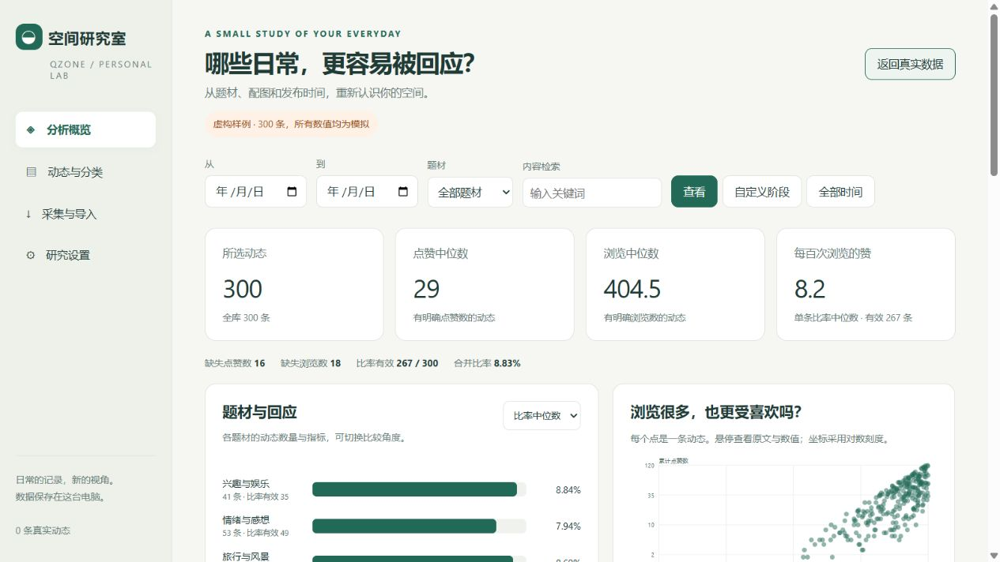

# 空间研究室 · Qzone Lab

一个本地运行的 QQ 空间动态分析工具：把个人动态整理成可探索的数据，比较题材、配图和发布时间与点赞、浏览之间的关系。

**状态：可运行的初版。** 提供采集、文件导入、人工分类、图表分析和报告导出；已用于一次个人动态分析。公开演示使用虚构数据。



## 问题与目标

生活记录中，哪些内容更容易得到回应？带图片的动态与纯文字动态有差异吗？生日、节日和发布时间是否与互动水平有关？

本项目将这些问题拆成三个观察角度：

- **浏览：** 一条动态被浏览了多少次。
- **点赞：** 一条动态获得多少赞。
- **点赞浏览比：** 每百次浏览获得多少赞。

既比较整体分布，也在同一年内比较题材，减少不同年份社交环境变化对观察结果的干扰。

## 功能

| 功能 | 内容 |
| --- | --- |
| 本人动态采集 | 在独立 Edge 窗口手动扫码登录，读取说说、点赞总数和单条浏览次数；支持日期范围和停止采集 |
| 文件导入 | CSV、原始说说 JSON、QZoneExport 说说备份 JSON、包含说说列表响应的 HAR |
| 主题整理 | 按文字关键词初分主主题，支持人工修改与自定义主题；再次导入保留人工分类 |
| 数据探索 | 日期、主题和关键词筛选；配图、年份、小时、星期、生日与节日比较；浏览与点赞散点图 |
| 同年比较 | 题材或配图对比同年其他动态，显示加权差异和重抽样区间 |
| 导出 | 筛选后的 CSV、JSON，以及 Markdown 分析报告 |
| 虚构演示 | 内置 300 条固定随机种子的模拟动态，不写入真实数据 |

## 环境与运行

分析页面及文件导入只需要 **Python 3.10+**，后端使用 Python 标准库，页面使用原生 HTML、CSS 和 JavaScript。

```bash
git clone https://github.com/menghuainanfang/personal-projects.git
cd personal-projects/leisure/qzone-lab
python app.py
```

浏览器会打开 `http://127.0.0.1:8765`。Windows 也可以双击 `启动空间研究室.cmd`。

### 扫码采集

采集器面向 Windows，需要本机安装 **Microsoft Edge**，并安装 Playwright：

```bash
python -m pip install -r requirements-collector.txt
```

Windows 也可以双击 `安装采集依赖.cmd`。在“采集与导入”中设置日期范围，点击“扫码登录并采集”，用手机 QQ 登录自己的账号。每条动态取得后即保存；重新采集按动态 ID 合并。

### 体验分析

首次启动没有真实数据，可以先点击“体验虚构样例”。公开版的日期范围、生日和纪念日默认为空；在“研究设置”中填写自己的研究阶段与公历生日，再通过“自定义阶段”快捷筛选。

关闭服务窗口或按 `Ctrl+C` 停止服务。端口被占用时可运行 `python app.py --port 8766`。

## 数据格式

每条记录至少需要发布时间。CSV 请使用 UTF-8；以下内容为虚构示例：

```csv
id,发布时间,内容,点赞数,浏览数,图片数,主题
example-1,2020-07-15 20:30:00,今天过生日,30,200,2,生日与纪念
```

也支持英文列名 `id,published_at,text,likes,views,image_count,topic`。统计缺失留空，0 表示确实为零；图片数缺失保留为未知。无时区的时间按北京时间解释，Unix 时间戳转换为北京时间。

JSON 可导入包含 `posts`、`msglist`、`data` 等列表的对象。原始说说读取 `tid`、`created_time`、`content`、`pictotal`；QZoneExport 备份还读取 `custom_content`、`custom_images`、`likeTotal` 和 `custom_visitor.viewCount`。点赞名单长度与访客名单长度不作为总数。

无 ID 时，以完整发布时间和正文识别重复导入。更新时保留已有非缺失统计及人工分类；`captured_at` 表示最近一次导入时间。

## 方法

### 描述统计

单条比率为 `点赞数 / 浏览数 × 100`。图表可切换点赞中位数、浏览中位数、单条比率中位数和合并比率。

合并比率为有效动态的总点赞数除以总浏览数再乘以 100；只使用两个总数都明确、浏览数为正且达到最低门槛的动态。中位数描述典型动态，合并比率更受高浏览动态影响。

### 同年比较

1. 将某题材与同年其余题材的平均单条比率作差；两侧均至少 3 条有效动态。
2. 使用两侧较小的样本量对各年差异加权合并。
3. 用固定随机种子进行 500 次按年份、组别分层的动态重抽样，近似计算 95% 百分位区间。

配图采用相同方法，并剔除图片数未知的动态。差异单位为每百次浏览的赞数。区间跨 0 表示当前样本的差异方向尚不稳定。

### 日期与主题

主题初分使用文字关键词，每条一个主主题，可人工复核。生日单列；其他命中的节日和纪念日合并比较。默认仅标记当天，支持自定义重复月日或指定年份的日期。内置春节、端午、中秋覆盖 2018—2026 年。

## 验证

```bash
python -m unittest discover -s tests -v
```

测试覆盖总数字段读取、缺失值与零值区分、重复导入、人工主题保留、CSV 与 HAR 解析、日期边界、合并比率的有效样本口径，以及导入到导出的本地流程。

同年比较使用一个明确的辛普森悖论样本验证：某题材总体比率更高，但两个年份内都低于其他题材，程序能够恢复同年比较的负向差异。

## 数据与隐私

动态正文、发布时间、互动统计和研究设置保存在程序目录的 `data/workspace.json`。分析与分类在本机完成，不调用远程模型；采集时通过腾讯接口读取当前登录账号的数据。

登录状态仅存在于本次独立浏览器会话中，程序不保存 Cookie 或登录凭据。HAR 导入只提取说说列表，不保存其请求头和登录参数。

`data/`、导入的 JSON / CSV / HAR、`exports/` 和 `reports/` 已列入项目忽略规则。需要备份个人记录时，另存 `data` 目录；需要分享程序时，分发源代码即可。自行公开分析报告或截图前，需要检查动态原文、账号信息、日期和个人设置。

## 限制

- QQ 空间接口不是公开稳定 API，登录过期、权限变化、平台验证或限流可能导致停止或缺失；接口可用性与数据完整性取决于实际账号。程序支持重新采集合并，不保存分页恢复点。
- 只有当前可访问动态及累计统计，删除或不可见动态不在样本中，不能恢复发布后固定时窗的表现。跨批次补齐的两个总数可能不在同一时刻取得。
- 浏览次数可能包含重复浏览，因此比率不是独立观看者点赞的概率。点赞大于浏览时应核对数据口径。
- 同年比较只控制年份，仍存在好友规模、互动关系、可见范围及动态年龄等混杂；结果说明关联，不构成因果结论。多题材探索未进行多重比较校正。
- 分类不分析图片内容；每条仅一个主主题。节日当天不等同于法定放假日或完整假期，其他年份与日期需要自行补充。
- 文件分析可通过 Python 启动；采集器使用 Windows Edge，其他系统的采集流程未验证。

## 项目结构

```text
qzone-lab/
├── app.py                       # 本地服务、导入与导出
├── analysis.py                  # 数据整理、主题与统计分析
├── collector.py                 # 本人动态只读采集
├── index.html                   # 分析界面
├── requirements-collector.txt   # 可选采集依赖
├── tests/                       # 计算与数据流程测试
├── assets/demo.jpg              # 虚构数据界面预览
├── 启动空间研究室.cmd
├── 安装采集依赖.cmd
├── .gitignore
└── README.md
```

## 后续方向

- 在保留人工主题的基础上支持多标签，区分内容题材与自拍、合照、风景等图片类型。
- 记录统一采集时刻或固定观察时窗，提高不同动态之间的可比性。
- 在数据足够时进一步比较同一学期的动态，考虑多因素模型。

## 参考资料与许可

接口字段和请求参数参考 [QZoneExport](https://github.com/ShunCai/QZoneExport) 的 `core/qzone-api/clients.ts`、`core/collector/modules/messages.ts` 和 `helpers.ts`。采集器为本项目的只读实现。

农历日期参考香港天文台[公历与农历日期对照表](https://www.hko.gov.hk/tc/gts/time/conversion.htm)。

原创代码和文档采用 [MIT License](LICENSE)。第三方数据和平台使用仍遵循各自条款。
