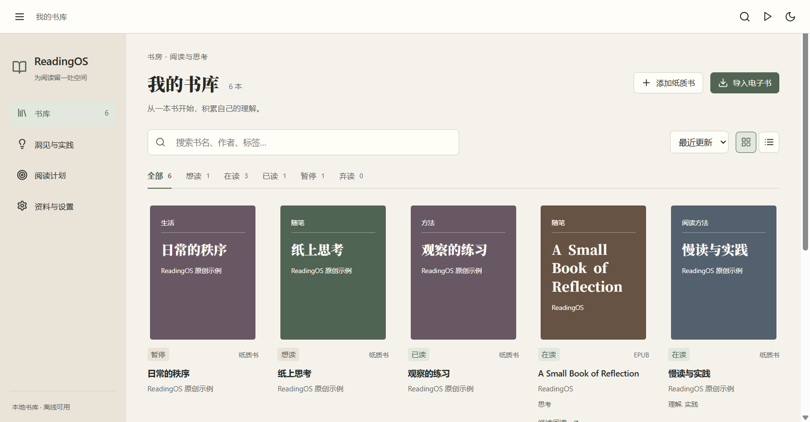

# v0.3 工作台与日历验收

2026-10-25，Windows x64，Electron 44.7.0，候选版本 0.3.0。Mantine core/hooks 9.7.3 与 @daypicker/react 10.0.2 已安装并在正式 Electron 渲染界面运行。SQLite 保持 schema v2。

生产构建、NSIS 构建和实际安装均成功，安装退出码 0。25 项数据/算法测试通过；最终安装程序上的 12+6+9+8 项桌面验收全部通过，页面错误为 0。交付包含 6 张旧版和 14 张新版实机截图。

## 实际行为

书库、书籍主页、洞见与实践、阅读计划共用 AppShell/Section/NavLink/ScrollArea；工具栏提供上下文、返回、查找、继续阅读与主题。书籍上下文显示当前书的实际日志、批注、洞见和行动，支持关闭与键盘/指针调宽。阅读器不挂载工作台，专注模式与原工具保持有效。

书籍开始/完成、日志、行动与反馈使用 DayPicker 单日网格，中文、周一开始、年/月下拉，支持输入、今天与可空字段清空。非法日期保留草稿并阻止提交；日期使用本地 YYYY-MM-DD。月份网格浏览不写库；确认式跨年范围真实参与批量书单排期。Popover 允许双轴边界调整，在小窗口及缩放下留在可见区域，Tab 限于日历，Esc 优先关闭日历并恢复按钮焦点。

## 可复现验证

| 命令 | 检查内容 |
| --- | --- |
| npm run build | TypeScript、Vite 生产包与 PDF 资源 |
| npm test | 25 项数据/导入/日期测试，包含 SQLite 回滚、迁移、完整备份、本地日期与三时区 |
| npm run test:desktop | 12 项完整阅读流程，含 PDF/EPUB、心得、日志、洞见、行动、反馈、重启和完整恢复 |
| npm run test:v02 | 6 项来源/偏好/主题专项，含四场景 × 三窗口 × 三缩放的 36 组布局 |
| npm run test:micro002 | 9 项真实文本/CSV/TSV/多选、重复导入、容量、SQL 故障回滚与重启 |
| npm run test:v03 | 8 项工作台/日期专项，含全部日期字段保存重开、中文周一、键盘、嵌套 Esc、跨年范围与重启 |

窗口组合包含 1280×720、1366×768、1920×1080，Chromium 100%/125%/150%。日期弹层另外验证 1280×720@150%、1366×768@125%、1920×1080@100%。测试使用原创资料、独立目录与离线浏览器上下文，结果 JSON 位于本机 test-results，交付摘要见同目录 `003-evidence.json`。

安装版复现：设置 `$env:READINGOS_EXECUTABLE='test-results/installed-v03/ReadingOS.exe'`，再运行各桌面命令。`READINGOS_TEST_DATA` 由测试指定，不读取个人书库。

## 数据与构建

真实个人资料在开发前已形成完整 `.readingos` 备份，位于仓库外 `D:\ReadingOS-private-backups\before-v03-2026-10-25T03-17-56-101Z`。已检查归档数据库与一致快照相同、SQLite 完整性、外键及全部原书引用。个人资料未用于破坏性测试，未进入 Git。

NSIS 使用自带 Electron、x64、压缩等级 5，安装包 `release/ReadingOS-0.3.0-win-x64-setup.exe`。验证分为生产构建、NSIS 构建、静默安装退出码和安装程序实际功能测试四层，最终结果记录在 evidence JSON。许可证和版权清单作为安装资源分发。

## 前后截图与资源

相同原创六书资料、1366×768 窗口，系统 DPR 1.25。前后截图在 `screenshots/iterations/003/{before,after}`，书库、书籍、阅读器、洞见、计划、日期表单使用对应文件名；新版增加实际日期弹层、月份、范围、上下文、深色及缩放截图。旧版具体日期使用原生输入，before 记录实际表单。

| 项目 | v0.2.1 | v0.3.0 |
| --- | ---: | ---: |
| 主入口 JS（构建文件） | 1,543,470 字节 | 1,812,243 字节 |
| 主入口 CSS | 292,222 字节 | 557,781 字节 |
| NSIS 安装包 | 131,729,260 字节 | 133,510,655 字节 |
| 启动到书库可见（单次） | 2,677 ms | 756 ms |
| 首屏进程工作集合计（单次） | 404.7 MiB | 452.0 MiB |

主 JS 与 CSS 包含真实工作台和日历代码；完整官方样式带来 CSS 增量，安装包仍主要由 Electron 与阅读资源构成。启动与各进程工作集的单次观察记录在 evidence JSON，口径为启动进程到书库可见、书库首次显示时的 Electron app metrics。缓存及同时运行的程序会影响读数，后续采用多设备样本评估优化。

## 已知限制与后续

本机覆盖不等同于独立屏幕阅读器或多设备系统 DPI 验证。完整样式和单入口包仍可按实际性能数据优化；上下文仅提供部分最近记录快捷入口。全依赖审计存在 Electron 证书公告和两项构建工具公告，详见 `docs/known_issues.md`；生产 npm 依赖审计为 0。v0.3 源码同步到 main；正式 Release 与运行时升级分别安排验证和授权。
